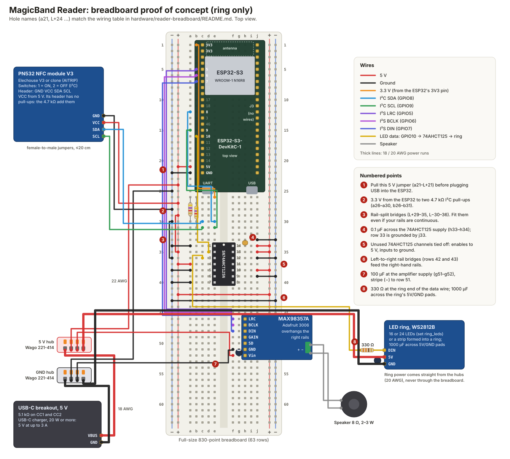
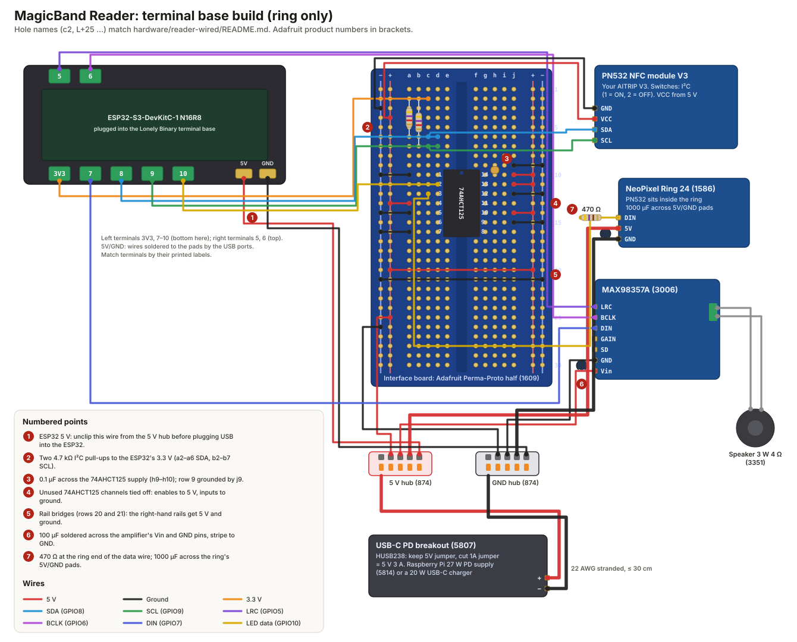
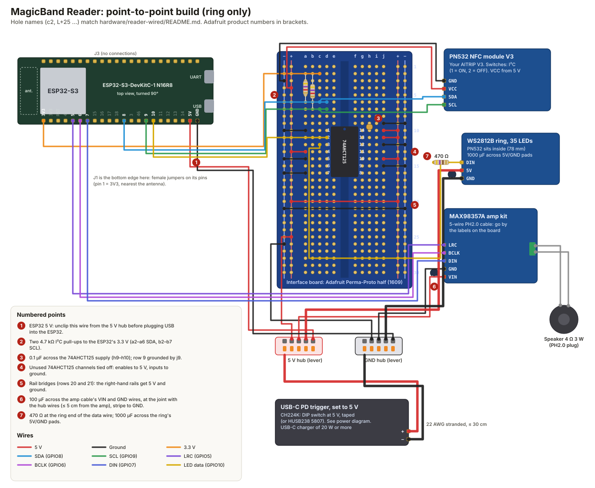
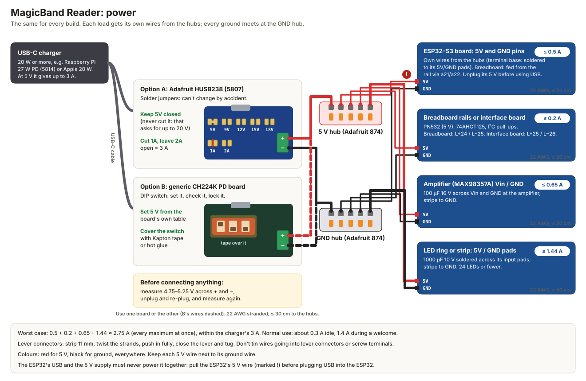

# MagicBand Reader

A park-style touch point for Home Assistant. Tap an **original MagicBand** or a
**MagicBand+** on it: two quick white circles chase round the ring while
it's checked, Home Assistant gets the band's ID, then the ring pulses in the
welcome colour (green, or the owner's own colour if MagicbHAnds gives them
one) with a chime, and a MagicBand+ lights up in the same colour and buzzes;
a band it doesn't let in gets two red pulses and the error sound.

Config: [`esphome/magicband-reader.yaml`](../esphome/magicband-reader.yaml).

Inspired by
[foolishmortalbuilders/magicbandreader](https://github.com/foolishmortalbuilders/magicbandreader),
[dcivitano/Magic-Band-Reader](https://github.com/dcivitano/Magic-Band-Reader) and
[ncory/MagicReader](https://github.com/ncory/MagicReader). Like them, it
identifies bands by their NFC ID. Unlike them, it runs on one ESP32 with
ESPHome and connects to Home Assistant natively (Tags, entities, actions). No
code from those projects is used.

## Ways to build it

Breadboard (start here), Lonely Binary terminal base or point-to-point
wiring. They share the parts, GPIOs and features. See
**[hardware/README.md](../hardware/README.md)** for a comparison and a
step-by-step check that a build works.

## How bands are read

Both band types contain a standard 13.56 MHz NFC chip (ISO 14443-A) with a
fixed ID, which is the same ID a phone app such as *NFC Tools* shows. The
reader only reads that ID, so no encrypted Disney data is involved. Original
MagicBands give a 7-byte ID like `04-53-65-2A-C0-5F-80`.

## Parts and wiring (breadboard)

**Parts: the [shopping list](../hardware/shopping-list.md)** (the generic
parts the guides use, and their Adafruit equivalents).

**Build it: the [step-by-step breadboard build](../hardware/reader-breadboard/build.md)**,
with a check after each stage. The [build spec](../hardware/reader-breadboard/README.md)
behind it has the reviewed parts list, the hole-by-hole wiring and the
power budget.



In short:

| Part | Specification |
|---|---|
| ESP32-S3 dev board | ESP32-S3-DevKitC-1 **N16R8** layout (Lonely Binary N16R8, or Espressif) |
| NFC reader | **PN532 NFC module V3** (AITRIP, Elechouse or similar), switches set to **I²C** (1 ON, 2 OFF), powered from **5 V**, with two 4.7 kΩ pull-ups to 3.3 V |
| LED ring | Any **5 V WS2812B ring** big enough for the PN532 to sit inside (the guides use a 35-LED ring, 78 mm inside; Adafruit's NeoPixel Ring 24 also works), or an SK6812 **RGBW** ring wired the same way. For a housing a ring won't fit, a flexible strip works too: [LED options](../hardware/shopping-list.md#if-a-ring-wont-fit-flexible-led-options) |
| Amplifier + speaker | **MAX98357A** I²S amplifier kit with a **4 Ω 3 W speaker** (or Adafruit's 3006 breakout and 3351 speaker) |
| Level shifter | **SN74AHCT125N** DIP for the LED data line, 470 Ω at the ring end |
| Power | **USB-C charger, 20 W or more**, through a CH224K **USB-C PD trigger set to 5 V** (or Adafruit's HUSB238 set to 5 V 3 A) |

| ESP32-S3 pin | Goes to |
|---|---|
| **5V** | 5 V rail (remove this jumper before plugging USB into the ESP32) |
| **GND** | Ground |
| **3V3** | The two I²C pull-ups |
| **GPIO8** / **GPIO9** | PN532 **SDA** / **SCL** |
| **GPIO10** | 74AHCT125 → 470 Ω → ring **DIN** |
| **GPIO5** / **GPIO6** / **GPIO7** | MAX98357A **LRC** / **BCLK** / **DIN** |

- **LED and amplifier power come straight from two lever-connector hubs**,
  not through the breadboard rails, and every ground meets at the GND hub.
- **Placement:** put the PN532 antenna in the centre of the ring, under the
  lid, with **no metal** between it and the band. Read range is a few
  centimetres through plastic.

### Terminal base and point-to-point builds

Once the breadboard works, the same circuit can be built smaller: on the
Lonely Binary **terminal-block base**, or **point-to-point** with Dupont
leads on the ESP32's pins. Both use a small perfboard **interface board**
for the level shifter and I²C pull-ups, and the same power hubs. See
**[hardware/reader-wired](../hardware/reader-wired/README.md)** for the
hole-by-hole layout and tests.

| Terminal base | Point-to-point |
|---|---|
|  |  |

### Powering it from a USB-C charger



Use a **USB-C charger of 20 W or more** (Apple 20 W, a laptop charger and
so on). At 5 V, USB-C gives **at most 3 A** whatever the charger's wattage,
which covers a ring-only reader (about 2.75 A worst case). Feed it in
through a **CH224K USB-C PD trigger** with its DIP switch set to 5 V,
checked with a meter and taped down, or an Adafruit HUSB238 breakout set to
5 V 3 A (keep its 5V jumper, cut its 1A jumper). Details and the current
budget:
[breadboard build spec](../hardware/reader-breadboard/README.md#power).

Don't run everything through the ESP32's own USB port. Keep that for the
first install, with the charger unplugged, and pull the ESP32's 5 V jumper
before plugging USB in later.

## Install

**Web installer: https://legal-copy7045.github.io/Magic-bHAnds/** (choose
*Install the reader*).

Install the firmware **before wiring anything else to the ESP32**, as step
1 of the build
([breadboard](../hardware/reader-breadboard/build.md),
[terminal base and point-to-point](../hardware/reader-wired/build.md)).

1. Plug the bare ESP32-S3 into your computer through the USB-C port
   labelled **UART**.
2. Open the web installer in Chrome or Edge, click **Install the reader**,
   then enter your Wi-Fi details when asked. Unplug it, then build the rest.
   Don't skip the Wi-Fi step, and add the reader to Home Assistant (next
   step) as soon as it's built and powered: a brand-new reader with no Wi-Fi
   set starts its open setup hotspot right away, and until it's added to Home
   Assistant whoever connects first could claim it. They can't install code
   on it, but you'd have to erase it and flash it again over USB
   ([security.md](security.md), "First connection").
3. Add it in Home Assistant when it's discovered (ESPHome). Leave **Allow
   the device to perform Home Assistant actions** (ESPHome → the reader →
   Configure) **off**: tag scans reach Home Assistant without it, and turning
   it on would let anyone who tampers with the reader (it's outside your
   door) call any action in Home Assistant, such as unlocking a lock.
4. Install the [MagicbHAnds integration](integration.md) to manage people and
   bands.

Firmware updates then appear in Home Assistant as an update on the reader,
and install over Wi-Fi: no USB needed. To **change its Wi-Fi** (a new router,
a new password) you don't need USB either: when the reader can't reach its
Wi-Fi for 2 minutes it starts its own open hotspot, **MagicBand Reader
Setup**. Join it from a phone, pick the new network on the page that opens
and enter its password; the hotspot goes away once the reader is back on
Wi-Fi (see [Changing Wi-Fi](#changing-wi-fi)). USB is only needed again to
see its start-up log, or if you'd rather use the web installer's *Change
Wi-Fi*. Before plugging USB into the built
reader, **first disconnect the ESP32's 5 V wire** from the 5 V rail or hub;
the rest can stay powered.

**Where the logs are:** over USB, the web installer's **Logs & console**
shows everything from start-up on. Over Wi-Fi, ESPHome → the reader →
Configure → turn on log subscription, then the reader's logs appear in
Home Assistant's log. The reader logs at INFO level: you see warnings and
errors (such as `Error sending version command` when the PN532 doesn't
answer) but never band IDs, so use its **Last band ID** and **Known bands**
entities to check taps.
The connection is encrypted: Home Assistant gives each reader its own key when
it first connects.

**Your ring or strip:** the web installer's firmware fits any of them. On
the reader's device page in Home Assistant, under **Configuration**, set:

- **LED count** (1–100, default 24): the number of LEDs in your ring or
  strip. Above the **Ring power budget** the reader caps their output so
  full white stays within it: at the default of 24, 24 ÷ count (35 LEDs:
  68 %). An RGBW ring draws more per LED (80 mA with everything on, against
  60 mA), so it gets three quarters of the budget: 18 ÷ count at 24.
- **Ring power budget** (12–35 LEDs, default 24): how much the ring may draw,
  in LEDs at full white (60 mA each, the datasheet's worst case; 24 is about
  1.44 A, sized for a 20 W charger with room for the ESP32 and the speaker).
  Raise it with **Full-power test** rather than by hand.
- **Full-power test** (button): lights every LED at full white at budgets of
  24, 26, 28, 30, 32 and 35 LEDs, 5 seconds each, and stops once a step no
  longer limits your ring. If the supply can't hold a step, the reader
  restarts, and when it comes back it sets the budget to the step below
  (20 if even 24 failed). If every step holds, the budget is the last step.
  The **Full-power test** sensor (under Diagnostic) says what happened. It
  catches a supply that sags or cuts out, not wires or a supply that get hot
  while still holding 5 V, which is why the budget stops at 35 (about 2.1 A
  for the ring, inside a 5 V 3 A supply). If you have a USB-C power meter,
  watch it during the test: the reader's total should stay under 3 A. A
  restart during the test for any other reason (unplugging it) also lowers
  the budget; run the test again.
- **LED colour order:** GRB for most NeoPixels and generic WS2812B rings; RGB
  for Adafruit's silicone neon-like strip (4310). If green shows as red,
  switch it.
- **LED brightness** (5–100 %, default 100 %): scales everything the ring
  shows, including the Ring light in Home Assistant. It works on top of the
  power cap, so it can only make the ring dimmer, never over budget.
- **Idle glow** (0–100 %, default 30 %): the glow (in **Idle colour**, default White) while waiting for a
  band; 0 turns the ring off between taps.
- **Ring type** (default RGB): RGB for a normal WS2812B ring, or **RGBW
  warm white / neutral white / cool white** for an SK6812 RGBW ring (pick the
  one matching its white LEDs). White and Warm white then use the white LED:
  on a warm-white ring, Warm white is the white LED alone (no colour LEDs), and
  White adds a little green and blue to cool it; on neutral and cool rings,
  White is the white LED alone and Warm white adds red and orange.
  The reader restarts when you change it. Set **LED count** too (35, 32, ...).
  The white mixes for neutral and cool rings are first guesses until they've
  been tried on real rings.
- **Idle glow at night** (0–100 %, default 10 %) with **Night from** (default
  22) and **Night until** (default 6), whole hours in the reader's local time
  (from Home Assistant): the idle glow used at night. Set both hours the same
  to use **Idle glow** all day.
- **Night mode** (default **Set hours**): when night is. **Set hours** uses
  **Night from** and **Night until**. **Sunset to sunrise** follows Home
  Assistant's sun instead, moved by **Night starts after sunset** and **Night
  ends after sunrise** (minutes, −240 to 240, default 0; negative = before),
  e.g. 30 and −30 for night from half an hour after sunset to half an hour
  before sunrise. The reader keeps the last sun times through restarts and
  uses the set hours until it has had them.
- **Night now** (diagnostic): on while the night idle glow applies.
- **Sound at night** (default **Normal**): quiet hours on the same night
  schedule. **Quieter** sets the speaker to **Night volume** (5–100 %,
  default 30 %) when night starts and puts back the volume it had in the
  morning; **Off** plays no reader sounds at night (welcome, denied,
  start-up, and people's own welcome sounds). After a power cut the reader
  waits up to 20 seconds for the time before its start-up sound; if it still
  doesn't know the time, the sound plays only with **Normal**.
- In **Warm white** the idle glow is mixed specially so it keeps its colour
  when dim (the Ring light shows the "Warm glow" effect at 100 %); its
  dimmest is a little brighter than the other colours' dimmest.

**The tap sequence** is set the same way, under **Configuration**:

| Setting | Default | What it does |
|---|---|---|
| **Idle colour** | White | Colour of the glow while waiting for a band (its brightness is **Idle glow**) |
| **Idle style** | Static | How the ring waits for a band: **Static**, a steady glow, or **Circle**, a circle going round in **Idle colour** at **Idle glow** (**Idle glow at night** at night) |
| **Idle circle time** | 3 s | With **Idle style** on Circle: how long one circle takes (0.5–10 s). Separate from the tap's **Circle time** |
| **Idle circle tail** | 0 (auto) | The idle circle's trail in LEDs; 0 = a fifth of the ring. Separate from the tap's **Circle tail** |
| **Idle tail fade** | 10 % | How bright the trail's last LED is, as a share of the head: 0 fades out, 100 is a solid bar |
| **Idle circle heads** | 1 | 1–4 heads spaced evenly round the ring, each with its own trail |
| **Idle circle direction** | Forward | **Reverse** runs the idle circle the other way round |
| **Idle style at night** | Same as day | At night (**Night now**): **Static** or **Circle** instead of **Idle style**, e.g. circling by day and a still glow at night |
| **Checking colour** | White | Colour of the circles that chase round the ring while a band is checked |
| **Checking circles** | 2 | How many circles before the result shows |
| **Circle time** | 0.5 s | How long one circle takes (0.2–2 s) |
| **Circle tail** | 0 (automatic) | How many LEDs long the chasing trail is (1 up to the LED count). 0 = a fifth of the ring, at least 3 (7 on a 35-LED ring) |
| **Welcome colour** | Green | Colour of the welcome pulse. A person's welcome colour set in MagicbHAnds overrides it for their bands |
| **Welcome pulses** | 1 | How many times it shows the welcome for a welcomed band (0.2 s apart) |
| **Welcome fade in** | 0.15 s | How quickly the welcome comes on (0 = instantly) |
| **Welcome hold** | 1 s | How long it stays fully on |
| **Welcome fade out** | 1 s | How slowly it fades out (0 = off at once) |
| **Denied colour** | Red | Colour of the denied pulse |
| **Denied pulses** | 2 | How many times it pulses for a band it doesn't let in |
| **Pulse time** | 0.45 s | How long one denied pulse (fade up and down) takes; pulses are a third of that apart |

Colours: White, Warm white, Red, Orange, Yellow, Green, Cyan, Blue,
Purple, Pink, Magenta. **LED brightness** scales them all.

**Refused-tap lockout** (off by default) guards against someone trying
band after band:

| Setting | Default | What it does |
|---|---|---|
| **Refused-tap lockout** | Off | Turn it on to use the lockout. Turning it off also ends a lockout in progress |
| **Lockout after** | 5 | How many refused taps start a lockout (2–20) |
| **Lockout window** | 60 s | ...within this many seconds (10–600) |
| **Lockout time** | 5 min | How long the reader then ignores taps (1–60) |

While locked out the ring pulses slowly in red and taps are ignored (not
read, not reported). **Tap lockout** (a problem sensor) is on meanwhile;
MagicbHAnds shows a notification and fires `magicband_lockout`. It works on
the reader itself, so it holds with Home Assistant offline too.

**Customising further** (sounds, pins): in the ESPHome Device Builder the
reader shows up with **Take control**, which imports
`esphome/magicband-reader.yaml` as a package; change its substitutions
there. The official firmware only accepts signed updates, so install your
first own build over USB (see [security.md](security.md), "Signed updates").
Your own builds don't have the setup hotspot below: add `ap:` (under
`wifi:`) and `captive_portal:` yourself if you want it, knowing that anyone
who joins it could then upload firmware to an unsigned build.

### Changing Wi-Fi

The official firmware starts a setup hotspot when it can't use its Wi-Fi:

1. When the reader can't reach its Wi-Fi for **2 minutes** (a new router, a
   changed password), or has no Wi-Fi set yet, it starts an open hotspot
   called **MagicBand Reader Setup** (your `friendly_name` + " Setup").
2. Join it from a phone or laptop. A page opens by itself (or browse to
   `http://192.168.4.1`): pick the new network and enter its password.
3. The reader connects and the hotspot goes away. While its Wi-Fi works, the
   hotspot never starts.

Over USB, the web installer's *Change Wi-Fi* (Improv) still works too. The
hotspot is open, so someone nearby during a Wi-Fi outage could join it and
set a different network, taking the reader offline until you set it back;
they can't install firmware through it, since the official firmware only
accepts updates signed with the project's key (see
[security.md](security.md), "Setup hotspot").

## Using it with Home Assistant

**Name your bands.** Tap each band once, then go to **Settings → Tags**. Each
band appears with its ID: give it a name ("Alex's MagicBand+").

**React to a band.** Create an automation with the trigger **Tag → Alex's
MagicBand+**, for example to turn on the lounge lights.

**Entities on the reader:**

| Entity | What it does |
|---|---|
| **Ring** | The LED ring as a normal HA light, so you can use it as a night light too. It glows in **Idle colour** while idle (brightness: **Idle glow**), and pulses slowly in amber while Home Assistant isn't connected |
| **Last band name** | Whose band was last tapped ("Morgan's MagicBand", or your name for the band), from the MagicbHAnds integration; attributes: NFC ID, person, allowed, time |
| **Last band ID** (diagnostic) | The raw NFC ID of the last band read |
| **Response mode** | *Known bands only* (default: decided on the reader; new bands are denied), *Welcome every band*, or *Ask Home Assistant* (see below) |
| **Band scan** | Event entity: every scan appears in the logbook as *welcomed* or *denied* |
| **Known bands** | How many bands are on the reader's allowed list |
| **Allow last band**, **Forget last band**, **Forget all bands** | Manage the reader's list by hand, if you don't use the MagicbHAnds integration (on a reader paired with MagicbHAnds they do nothing: manage bands there) |
| **Speaker** | Media player: Home Assistant can also play announcements and TTS through the reader |
| **Light up MagicBand+** | Send the welcome colour + buzz to a MagicBand+ on a successful read (default on) |
| **Band light-up power** | How far that light-up reaches, −24 to 0 dBm (default −12). A broadcast can't be addressed to one band, so every MagicBand+ in range reacts: lower it until only the band on the reader lights up. Each −6 dB roughly halves the reach |
| **Sound** | Chimes on/off |
| **Test welcome** | Plays the welcome sequence without a band |
| **Play show** | Plays the light show chosen in **Show** (or a random one) |
| **Show** | Which show **Play show** plays: Random (one of the everyday shows), or Rainbow rush, Fireworks, Comet chase, Colour parade, Twinkle, Heartbeat, Ocean, Fire, Pinwheel, Confetti, Penguins (black and gold), Goal (three red pulses), Aurora, Candy cane, Thunderstorm, Sunrise, Disco; the celebration shows Birthday, New Year, Valentine, St Patrick, Easter, Stars and Stripes, Halloween, Thanksgiving, Hanukkah and Christmas; or Stamp (a new passport badge). The MagicbHAnds integration plays the celebration shows after a welcome on the day (see [integration.md](integration.md#celebrations-and-the-tap-passport)); a show sent during a tap waits for the welcome to finish (it's queued, not dropped). The reader plays at most 12 shows a minute from Home Assistant (its play_show action), whoever calls it; the action answers with an error (`SHOW_RATE_LIMIT`, or `SHOW_NOT_READY` while the reader starts) when it doesn't take a show |
| **Startup show** | The show played when the reader starts: Off, Random or one show (default Rainbow rush) |
| **Allowed list** (diagnostic) | From the MagicbHAnds integration: whether this reader has the current allowed list (*Up to date*, *Not applied*, *Reader offline* …) |
| **ESPHome name** (diagnostic) | The reader's ESPHome name; the integration uses it to find the reader's actions |
| **Firmware** | Update entity: new firmware appears here and installs over Wi-Fi |
| **Automatic updates** | Off by default. On: the reader installs a new release by itself between 3 and 4 am (local time, by its internet clock), without Home Assistant starting it. Only signed releases install, and only one newer than the reader has: it never goes back to an older release by itself. An update you start from **Firmware** installs whichever signed release the site offers |
| **Time zone** | Eastern (New York) | The reader's local time zone (night mode, automatic updates). The reader keeps time from an internet time server as well as from Home Assistant, so the schedule works while Home Assistant is down |
| **Restart** (diagnostic) | Restarts the reader |
| **Wi-Fi signal**, **Wi-Fi network**, **IP address** (diagnostic) | Its connection; the signal is sent when it changes by 3 dB, or every 5 minutes |
| **CPU temperature** (diagnostic) | The ESP32's own sensor: a trend for spotting a hot case, not an exact reading |
| **Last restart**, **Reset reason** (diagnostic) | When it last started and why (power on, software restart, crash) |
| **Free memory**, **Largest free block**, **Loop time** (diagnostic) | Early warning of memory trouble or a busy reader, every 5 minutes |
| plus the MagicBand bridge entities | MagicBand light, Buzz, Command, Prefix mode and so on |

### Pairing with MagicbHAnds

With the MagicbHAnds integration, each reader is **paired** with it (reader
firmware 0.10.20 and later), so only MagicbHAnds can change who the reader
lets in. The first time, the ring **breathes blue** and Settings → Repairs
asks you to **tap any band on the reader** within 2 minutes; the ring turns
green and the reader is paired (that tap does nothing else). The **Paired
with MagicbHAnds** sensor shows it. A paired reader keeps its pairing through
restarts, power cuts and updates. To move it to another Home Assistant, call
`magicband.unpair_reader` first (this Home Assistant then leaves it alone;
`magicband.pair_reader` takes it back), or erase it over USB with the web
installer.
Any Home Assistant user can call a reader's pair action, so on a new
(unpaired) reader the first request wins: it waits 2 minutes for the tap and
asking again doesn't extend that. Meanwhile any other key is refused
(`PAIRING_BUSY`), and after an unconfirmed wait the same key must leave a
2-minute gap in which another key can ask. Only tap a band when MagicbHAnds
asks you to in Repairs: it asks only while the reader tells it its own
request is the one waiting (another key's request is answered `PAIRING_BUSY`).
See [security.md](security.md).

### No waiting on Home Assistant

Everything the reader does is handled on the reader itself: reading the band,
lights, sounds and the MagicBand+ feedback. Home Assistant is only told about
the scan, and the reader never waits for it. The one exception is *Ask Home
Assistant* mode.

### "Known bands only" mode (default): green for your bands, red for others, decided instantly

A band's first scan gets the denied sequence. The reader stores its allowed
list itself, with room for 213 bands (7-byte IDs), so it answers instantly
and keeps working when Home Assistant is offline. A list that's too long or
malformed empties the reader's list (every band is denied) rather than leave
an old one in place.

**Recommended:** manage people and bands with the
[MagicbHAnds integration](integration.md). It logs scans, alerts you about new
bands, lets you give bands to people, including people who aren't HA users and
people with several bands, and keeps every reader's list in sync.

**Without the integration:** tap the band, then press **Allow last band** on
the reader's device page. **Forget last band** (tap it first) and **Forget
all bands** remove entries. On a reader paired with MagicbHAnds the three
buttons do nothing (any Home Assistant user can press them): the integration
manages the list.

### "Ask Home Assistant" mode: let an automation decide

Use this only if HA needs to decide, for example based on time of day or who's
home. The white circles keep chasing until HA answers, and with no answer within 3 seconds it
pulses red twice. Add an automation that answers:

```yaml
alias: "MagicBand reader: allow known bands"
triggers:
  - trigger: event
    event_type: tag_scanned
    event_data:
      device_id: YOUR_READER_DEVICE_ID   # optional: only this reader
actions:
  - if:
      - condition: template
        value_template: >
          {{ trigger.event.data.tag_id in ['04-53-65-2A-C0-5F-80', '04-11-22-33-44-55-66'] }}
    then:
      - action: magicband.answer
        data: {device_id: YOUR_READER_DEVICE_ID, allow: true}
    else:
      - action: magicband.answer
        data: {device_id: YOUR_READER_DEVICE_ID, allow: false}
```

With the integration, use `magicband.answer` as above: the reader is paired
with MagicbHAnds and only takes an answer that carries its key, which
`magicband.answer` adds (and only administrators and automations can call
it). Without the integration, call the reader's own
`esphome.magicband_reader_XXXXXX_accept` / `_deny` actions with an empty
`key`.

## Phones and watches

Disney's phone and watch passes (MagicMobile in Apple and Google Wallet) use
the wallets' encrypted protocols, which need Apple's, Google's and Disney's
keys, and phones don't present a fixed NFC ID. So the reader can't recognise
a phone or watch. As an alternative, stick an NFC tag on the reader and scan
it with the Home Assistant Companion app. An automation on that tag can run
the reader's welcome sequence (press **Test welcome**, or call its actions).
That goes through Home Assistant, so it's slightly slower than a band.

## Sounds

The reader plays three sound files, embedded in the firmware at build time so
they play instantly with no network involved:

| File | When |
|---|---|
| `sounds/startup.wav` | Reader starts up |
| `sounds/tap_in.wav` | Band accepted |
| `sounds/error.wav` | Band denied |

The sounds were recorded by the project owner and are included in this repo,
in `esphome/sounds/`. The reader downloads them from GitHub when it's built,
so there's nothing to copy onto Home Assistant.

**Using your own sounds instead:**

1. Convert each one to **mono, 16-bit, 48 kHz WAV**. This keeps them small and
   matches the speaker. With ffmpeg:
   `ffmpeg -i in.wav -ac 1 -ar 48000 -sample_fmt s16 out.wav`
2. Either host them somewhere and put the URLs in `sound_startup`,
   `sound_tap_in` and `sound_error` at the top of the config, or put them in
   `/config/esphome/sounds/` on Home Assistant (File editor, Samba or Studio
   Code Server add-on) and set those values to `sounds/startup.wav` and so on.
3. Install the reader from the Device Builder. The files are embedded each
   time you build, and each must be under 5 MB.

**A welcome sound for one person:** with MagicbHAnds, upload it on the
MagicbHAnds page (People → that person). No rebuild: Home Assistant plays it
on the reader when it welcomes their bands, instead of `tap_in.wav`. While
Home Assistant isn't connected the reader plays `tap_in.wav` for them. See
[Welcome sounds](integration.md#welcome-sounds).

**Quiet hours:** **Sound at night** (Quieter or Off) lowers or silences the
reader at night, on the same schedule as **Idle glow at night**.

## Notes

- The MagicBand+ feedback uses Bluetooth, so it reaches **any** MagicBand+
  nearby, not only the one on the reader. The reader transmits at −12 dBm by
  default (the **Band light-up power** setting) to keep that local.
- Taps during a sequence are ignored; tap again once the reader is idle.
- Bands the reader doesn't know reach Home Assistant as tag scans, with only
  a flood guard: at most 60 new bands a minute and 600 an hour, in every mode
  (a band tapped again soon after always goes). That's far more than people
  can tap one reader, so enrolling a family's bands or a queue of guests in
  *Ask Home Assistant* mode never hits it; it only stops a tag emulator
  cycling made-up IDs from filling Home Assistant's tag list without bound.
  The reader still welcomes or denies every tap as usual. Never held back:
  bands on its allowed list, and bands that have been on it since it was set
  up (the last 128, kept through restarts), so a household band that's off
  the list for now (outside its hours, during a lockdown) still shows up in
  MagicbHAnds' history and refusal notices.
