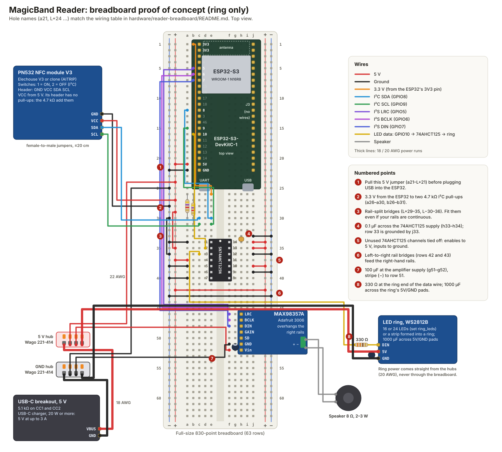
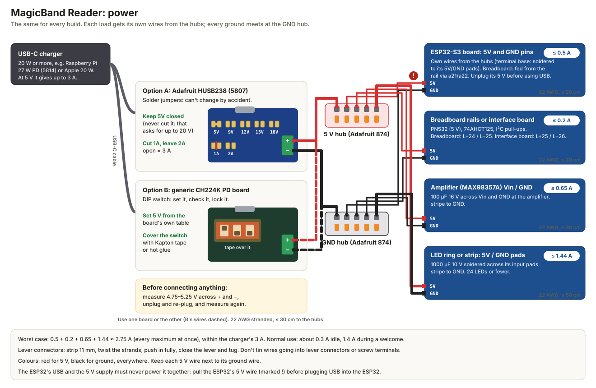

# MagicBand Reader: breadboard proof of concept

The reference build: one ESP32-S3 dev board, a PN532 NFC reader, one LED
ring, a MAX98357A amplifier and speaker, on a single full-size breadboard,
powered from a USB-C charger (20 W or more). The other builds (terminal base,
point-to-point) should be checked against this build once it works.

**Building it? Follow the [step-by-step build](build.md).** This page is the
reference behind it: parts, power, the hole-by-hole wiring and the review.

**Status:** reviewed against manufacturer documents (sources at the end),
**not yet built**. Nothing here is proven until the
[step-by-step build](build.md) passes its checks on real parts.
Items marked *estimate* are engineering estimates, not datasheet values.

## Verdict

**Ready to build** with the parts, wiring and power arrangement below. This
replaces the earlier breadboard documentation, which had these problems:

| # | Problem in the earlier documentation | Correction |
|---|---|---|
| 1 | The ESP32 board was drawn mirrored (J1 on the right) with its headers 11 holes apart. Viewed from the top with the antenna up, J1 is on the **left**, and the headers are **9 holes** (22.86 mm) apart. | One breadboard, J1 in column c, J3 in column j |
| 2 | LED power ran through the breadboard rails and jumper wires | LED power comes straight from two lever-connector hubs |
| 3 | PN532 VCC was 5 V in one table and 3V3 in another; no I²C pull-ups | PN532 on **5 V**, plus 2 × 4.7 kΩ pull-ups to 3.3 V (the module has none on its header side) |
| 4 | 330 Ω resistor at the level shifter | At the **ring end** of the data wire (Adafruit's guidance) |
| 5 | 0.1 µF decoupling drawn but not in the parts list; capacitors had no voltage ratings | Listed below with ratings and positions |
| 6 | Nothing stopped USB and the 5 V supply feeding the ESP32 together | One jumper (a21) to remove before plugging in USB |
| 7 | No check for split breadboard rails | Rail bridges fitted, and a continuity check |
| 8 | 24 + 12 LEDs could draw ≈ 3.5 A in total, over a 3 A supply | **Ring only** (16 or 24 LEDs): ≈ 2.1–2.6 A worst case |

## Parts

Written for these generic parts (the Adafruit equivalent of each is in the
[shopping list](../shopping-list.md#adafruit-equivalents)):

| Qty | Part | Specification | Notes |
|---|---|---|---|
| 1 | ESP32-S3 dev board | **ESP32-S3-DevKitC-1 N16R8** layout (Lonely Binary N16R8, or Espressif), headers fitted | The firmware needs 16 MB flash and octal PSRAM. Check a clone's pin labels match the [pinout](#esp32-s3-devkitc-1-j1-pins-used). IPEX version: fit the antenna |
| 1 | NFC reader | **PN532 NFC module V3** (AITRIP, Elechouse or similar), with its 4-pin header | Set to I²C (switch 1 ON, switch 2 OFF) |
| 1 | LED ring | **WS2812B ring, 35 LEDs, 5 V, 78 mm inside** (any WS2812B/SK6812 5 V ring works) | The PN532 (43 × 41 mm) sits inside it, clear of the antenna. Set **LED count** to match; above 24 LEDs the firmware caps their power. Its bundled USB remote isn't used |
| 1 | Amplifier and speaker | **MAX98357A I²S amplifier kit** with a **4 Ω 3 W speaker**: 5-pin PH2.0 connector (printed **G, V, BCL, LRC, DIN** on the tested kit; go by the labels on yours), PH2.0-to-Dupont cable, PH2.0 speaker socket | The amplifier sits off the board on its cable. Gain and shutdown are set on the board |
| 1 | Level shifter | **SN74AHCT125N**, 14-pin DIP | Not 74HC125, and not a MOSFET "level shifter module" |
| 2 | Resistor | 4.7 kΩ, ¼ W | I²C pull-ups |
| 1 | Resistor | **470 Ω**, ¼ W | LED data, at the ring. 300–500 Ω is fine |
| 1 | Capacitor | 1000 µF, **10 V** or higher, electrolytic | Across the ring's 5V/GND pads |
| 1 | Capacitor | 100 µF, **10 V** or higher, electrolytic | Amplifier supply |
| 1 | Capacitor | 0.1 µF ceramic (marked **104**) | 74AHCT125 supply |
| 1 | Breadboard | Full-size **830-point**, 63 rows, power rails both sides | |
| 2 | Lever connectors | **5-way lever connector** for 12–24 AWG (Wago 221-415 or similar) | One for 5 V, one for GND: the power hubs |
| 1 | USB-C PD trigger | **CH224K PD trigger board**, 5–20 V by DIP switch, **set to 5 V** and the switch taped | See [Power](#power). The Adafruit HUSB238 (5807) also works |
| 1 | Charger | **USB-C charger of 20 W or more** (laptop or phone charger) and a USB-C cable rated 3 A | At 5 V a USB-C charger gives at most 3 A |
| — | Wire | **22 AWG stranded**, red, black and four or five other colours | Power runs, the ring's wires, the LED data wire. Tin the ends that go into the breadboard (not the lever-connector ends). [Wiring guide](../shopping-list.md#wiring-guide) |
| — | Jumpers | Breadboard jumper set (male-to-male) and **4 male-to-female** Dupont jumpers for the PN532 | |
| — | Consumables and tools | Solder, heat shrink, tape; soldering iron, wire strippers, **multimeter** (DC volts, continuity) | [Shopping list](../shopping-list.md#wire-and-consumables-every-build) |

## Power

### Supply

Use a **USB-C charger of 20 W or more**. Any such charger supplies 3 A at
5 V; more watts don't help, because at 5 V USB-C allows **at most 3 A**
(15 W), and a charger's higher ratings only exist at 9–20 V. The budget
below fits within 3 A.

**USB-C PD trigger board (CH224K):** it asks the charger for the voltage its
DIP switch selects, from 5 to 20 V. Every part of the reader is a 5 V part,
and 9 V or more destroys them, so:

1. Set the switch to **5 V** using the table printed on the board or in its
   listing. Boards often ship set to 12 V or 20 V.
2. With **nothing connected** to its output, plug it into the charger and
   measure **4.75–5.25 V** across + and −. Unplug, plug in again, and
   measure again.
3. **Cover the switch** with tape or hot glue, so it can't be knocked to
   another voltage.

**Or the Adafruit HUSB238 breakout (5807):** keep the 5V jumper closed
(never cut it: with no voltage jumper it asks for up to 20 V), cut the 1A
jumper (3 A), and measure as above.

Avoid plain USB-C socket breakouts without CC resistors: a standards-
compliant charger won't switch on. A USB-C "breadboard power supply"
module can't replace the PD board unless its 5 V output is rated for 3 A,
and must never be connected at the same time as it.

### Current budget

| Load | Normal | Peak in use | Worst case | Basis |
|---|---|---|---|---|
| ESP32-S3 board (Wi-Fi + Bluetooth) | 0.15 A | 0.35 A | 0.50 A | *estimate* (Espressif's chip datasheet couldn't be retrieved) |
| PN532 module (polling every 250 ms) | 0.10 A | 0.15 A | 0.15 A | *estimate* (NXP datasheet couldn't be retrieved) |
| LED ring (35 × WS2812B, capped at 24 ÷ 35) | 0.05 A (idle glow) | 0.48 A (welcome, full green) | **1.44 A** (full white) | 60 mA per LED at full white (Adafruit), so 24 LEDs' worth at most: the firmware caps rings over 24 LEDs; one colour *estimated* at a third of that |
| MAX98357A + 4 Ω speaker | 0.003 A | 0.30 A | 0.65 A | 2.4 mA quiescent (datasheet); up to 650 mA at 5 V into 4 Ω (Adafruit) |
| 74AHCT125, pull-ups, board LEDs | 0.01 A | 0.01 A | 0.01 A | 74AHCT125 ≤ 20 µA (TI) |
| **Total** | **≈ 0.3 A** | **≈ 1.4 A** | **≈ 2.75 A** | |

- **Normal** is idle: the ring glowing white at 30 % (ESPHome's gamma
  correction makes that about 3 % of full power), nothing playing.
- **Peak in use** is a welcome: ring full green, sound playing.
- **Worst case** is Home Assistant setting the ring to full white while a
  sound plays at full volume and Wi-Fi transmits. **LED brightness** below
  100 % lowers it further.
- **Headroom on 3 A:** about 8 % in that worst case, which stacks every
  maximum at once. In use the reader stays under half the supply.

### Distribution

On the breadboard, the hubs feed the **L+/L− rails at rows 24/25**; the
rails feed the ESP32 (through the a21/a22 jumpers), the PN532 and the
74AHCT125. The amplifier (rows 51/52) and the ring have their own wires
from the hubs.

- **One ground point:** every ground meets at the GND hub. The ring's and
  amplifier's currents never flow through the breadboard.
- **The breadboard rails carry only the ESP32, PN532 and level shifter**
  (≤ 0.7 A worst case).
- Keep the hubs within about 30 cm of the breadboard and the ring. With
  22 AWG (about 53 mΩ/m), 1.44 A over 0.5 m each way drops about 80 mV,
  and 2.75 A over 0.3 m each way about 90 mV.
- **USB and the 5 V supply must never feed the ESP32 together.** Espressif
  lists USB, the 5V pin and the 3V3 pin as mutually exclusive power options.
  The board's USB ports feed its 5 V through Schottky diodes, so the charger
  can't push current into your computer. With the charger off and USB in,
  though, your computer would try to power the whole 5 V rail. So:
  **pull the a21 jumper before plugging USB into the ESP32**, and put it
  back afterwards.

## Wiring

Holes are named by column and row (`a21`) or rail and row (`L+24`: left
red rail at row 24). Rows run 1–63 from the top; columns are `L−` `L+` `a–e`
(channel) `f–j` `R+` `R−`.

### Placement

| Part | Holes | Orientation |
|---|---|---|
| ESP32-S3-DevKitC-1 | J1 in **c1–c22**, J3 in **j1–j22** | Antenna towards row 1, USB ports towards row 25, component side up |
| 4.7 kΩ (SDA pull-up) | a26 – a30 | Lying flat |
| 4.7 kΩ (SCL pull-up) | b26 – b31 | Lying flat |
| 74AHCT125 | pin 1 in **e34**, pins 1–7 down column e (rows 34–40), pins 14–8 down column f | Notch towards row 1 |
| 0.1 µF ceramic | h33 – h34 | |
| MAX98357A kit | **Off the board**, on its PH2.0-to-Dupont cable: **LRC h46, BCLK h47, DIN h48, GND h51, VIN h52** (rows 49–50 stay empty) | Go by the labels printed on the amplifier, not the cable colours |
| 100 µF electrolytic | **g51 (−)**, g52 (+) | Stripe towards row 51 |

### Connections

| From | To | Signal | Notes |
|---|---|---|---|
| PD trigger output **+** | 5 V hub | 5 V | 22 AWG stranded red, ≤ 30 cm |
| PD trigger output **−** | GND hub | GND | 22 AWG stranded black, ≤ 30 cm |
| 5 V hub | L+24 | 5 V to the breadboard | 22 AWG red, breadboard end tinned |
| GND hub | L−25 | GND to the breadboard | 22 AWG black, breadboard end tinned |
| L+29 | L+35 | 5 V rail bridge | Bridges a rail split; harmless if there's none |
| L−30 | L−36 | GND rail bridge | As above |
| L+42 | R+42 | 5 V to the right rail | |
| L−43 | R−43 | GND to the right rail | |
| a21 (ESP32 **5V** pin) | L+21 | 5 V into the ESP32 | **Remove before plugging in USB** |
| a22 (ESP32 **GND**) | L−22 | GND | |
| b1 (ESP32 **3V3**) | e26 | 3.3 V for the pull-ups | |
| a12 (**GPIO8**) | e30 | I²C SDA | |
| a15 (**GPIO9**) | e31 | I²C SCL | |
| c30 | PN532 **SDA** | I²C SDA | female-to-male jumper |
| c31 | PN532 **SCL** | I²C SCL | female-to-male jumper |
| L+27 | PN532 **VCC** | 5 V | female-to-male jumper |
| L−28 | PN532 **GND** | GND | female-to-male jumper |
| b16 (**GPIO10**) | d35 (74AHCT125 pin 2, 1A) | LED data, 3.3 V | |
| a34 (pin 1, 1OE) | L−34 | Enables channel 1 | |
| a37 (pin 4, 2OE) | L+37 | Disables channel 2 | |
| a38 (pin 5, 2A) | L−38 | Unused input to GND | TI: unused inputs must be tied |
| a40 (pin 7, GND) | L−40 | IC ground | |
| j34 (pin 14, VCC) | R+34 | IC supply, 5 V | |
| j35 (pin 13, 4OE) | R+35 | Disables channel 4 | |
| j36 (pin 12, 4A) | R−36 | Unused input to GND | |
| j38 (pin 10, 3OE) | R+38 | Disables channel 3 | |
| j39 (pin 9, 3A) | R−39 | Unused input to GND | |
| j33 | R−33 | Grounds row 33 for the 0.1 µF | |
| c36 (pin 3, 1Y) | 470 Ω → ring **DIN** | LED data, 5 V | 22 AWG; the resistor is soldered inline at the ring end, in heat-shrink |
| b5 (**GPIO5**) | f46 | I²S LRC | |
| b6 (**GPIO6**) | f47 | I²S BCLK | |
| b7 (**GPIO7**) | f48 | I²S DIN | |
| 5 V hub | f52 | Amplifier VIN | 22 AWG red, breadboard end tinned |
| GND hub | f51 | Amplifier GND | 22 AWG black, breadboard end tinned |
| Amplifier cable **LRC / BCLK / DIN** | h46 / h47 / h48 | I²S | If the cable's Dupont ends are female, push a short male-to-male jumper into each |
| Amplifier cable **GND / VIN** | h51 / h52 | Amplifier power | As above |
| 5 V hub | Ring **5V** pad | LED power | 22 AWG stranded red, ≤ 50 cm |
| GND hub | Ring **GND** pad | LED power return | 22 AWG stranded black, ≤ 50 cm |
| 1000 µF + / − | Ring 5V / GND pads | Bulk capacitor | Soldered at the ring, stripe to GND |
| Amplifier PH2.0 speaker socket | Speaker | Audio | The speaker's own plug. Neither wire is ground (bridge-tied output) |

Left unconnected: 74AHCT125 pins 6, 8 and 11 (unused outputs); ESP32 J3.
The amplifier kit sets its gain and shutdown/channel on the board.

### ESP32-S3-DevKitC-1 J1 pins used

From Espressif's v1.1 pin table, pin 1 nearest the antenna: 1 **3V3**, 2 3V3,
3 RST, 4 GPIO4, 5 **GPIO5**, 6 **GPIO6**, 7 **GPIO7**, 8 GPIO15, 9 GPIO16,
10 GPIO17, 11 GPIO18, 12 **GPIO8**, 13 GPIO3, 14 GPIO46, 15 **GPIO9**,
16 **GPIO10**, 17–20 GPIO11–14, 21 **5V**, 22 **GND**. On the breadboard,
pin *n* is row *n*.

None of the used GPIOs is a strapping pin (GPIO0, 3, 45 and 46 are) or used
by the board's flash and PSRAM (GPIO35–37).

## Component review

| Component | Selection | Verdict | Required change | Reason |
|---|---|---|---|---|
| ESP32-S3 board | DevKitC-1 N16R8 / Lonely Binary N16R8 | PASS WITH CONDITIONS | Check a clone's pin labels against the table above | Pinout, 5 V input path and regulator verified on Espressif's v1.1 schematic. Not verified for the Lonely Binary board |
| GPIO assignment | 5, 6, 7 I²S; 8, 9 I²C; 10 LEDs | PASS | — | No strapping, USB, flash or PSRAM pins; matches the firmware |
| PN532 module | V3 (Elechouse / AITRIP clone) | PASS WITH CONDITIONS | VCC on 5 V; add 4.7 kΩ pull-ups; check the clone (test stage 2) | Elechouse schematic: MOSFET level shifter, 4.7 kΩ pull-ups only on the chip side (to its own 3.3 V), no pull-ups on the header. The clone isn't verified |
| PN532 supply voltage | 5 V vs 3.3 V (docs conflicted) | CHANGE REQUIRED | 5 V | The module feeds VCC to the PN532's VBAT. At 3.3 V the reset divider (10 k/20 k) gives about 2.2 V |
| WS2812B LEDs | 24 ring + 12 Mickey | CHANGE REQUIRED | Ring only; over 24 LEDs (e.g. the 35-LED ring) the firmware caps power at 24 LEDs' worth | 36 LEDs at full white (2.16 A) plus the rest exceeds 3 A |
| Level shifter | 74AHCT125 / 74AHCT1G125 | PASS (SN74AHCT125N) | Use the DIP version | WS2812B needs 0.7 × VDD = 3.5 V high; 74AHCT125 accepts 2.0 V and outputs ≥ 3.8 V (TI) |
| 330 Ω resistor | At the shifter | PASS WITH CONDITIONS | 470 Ω (Adafruit sells no 330 Ω), at the ring end | Adafruit: "at the end of the wire closest to the NeoPixel(s)" |
| 1000 µF capacitor | No rating or position given | PASS WITH CONDITIONS | 10 V, at the ring's pads | Adafruit: 500–1000 µF, 6.3 V or higher |
| 0.1 µF capacitor | Drawn, not listed | CHANGE REQUIRED | Add to the parts list, at the IC | Standard supply decoupling |
| I²C pull-ups | None | CHANGE REQUIRED | 2 × 4.7 kΩ to 3.3 V | The module's header side has none; the ESP32's internal pull-ups are weak |
| MAX98357A | 5-pin amplifier kit (or Adafruit 3006) | PASS WITH CONDITIONS | Own supply wires; 100 µF at VIN; pins by the board's labels | 2.5–5.5 V supply, 1.3 V logic threshold (datasheet); Adafruit budgets 650–800 mA. The kit's on-board gain and SD settings aren't documented: if it plays, they're fine |
| Speaker | 4 Ω 3 W (in the kit) | PASS | — | Rated for the amplifier's 3 W into 4 Ω; 0.65 A fits the budget |
| Power supply | 5 V 3 A | PASS WITH CONDITIONS | USB-C charger ≥ 20 W; CH224K PD trigger set to 5 V and taped (or HUSB238 at 5 V 3 A); verify before connecting | Worst case ≈ 2.75 A |
| Power distribution | Breadboard rails | CHANGE REQUIRED | Hubs; LED and amplifier wired directly | Breadboard contacts aren't meant for amps of LED current |
| Firmware | `magicband-reader.yaml` | PASS | — | See below |

## Firmware cross-check

Checked against `esphome/magicband-reader.yaml` and ESPHome's source:

- **I²C:** SDA GPIO8, SCL GPIO9, 50 kHz (ESPHome default), internal pull-ups
  on (default; they sit in parallel with the 4.7 kΩ), bus scan on.
- **PN532:** `pn532_i2c`, address 0x24 (ESPHome default), polled every 250 ms.
- **LEDs:** `esp32_rmt_led_strip` on GPIO10, WS2812, **GRB** (the WS2812B
  datasheet's order), 24 LEDs by default, off at boot, gamma 2.8. **LED
  count** (1–100) and **LED colour order** (GRB/RGB) are settings on the
  device page. Up to 24 LEDs there's no brightness cap, which is why the
  supply is sized for full white; above 24 the reader caps the output at
  24 ÷ count, so full white stays at 1.44 A. **Ring type** (RGB, or RGBW
  warm/neutral/cool white) selects an SK6812 RGBW ring, capped at 18 LEDs'
  worth (80 mA each with everything on).
- **I²S:** LRCLK GPIO5, BCLK GPIO6, DOUT GPIO7, external DAC, mono. The
  MAX98357A needs no MCLK. *Not verified:* whether ESPHome's mono mode fills
  one I²S slot or both. If only one, the (L+R)/2 mix halves the level, which
  only affects volume.
- **Logs:** on UART0, so use the board's **UART** USB port for the first
  install and serial logs.

## Build and test

The staged build, with a measurement and a check after each stage, is in
the **[step-by-step build](build.md)**.

## Sources

- Espressif ESP32-S3-DevKitC-1 v1.1 user guide (pin tables, power options),
  board schematic (USB-to-5V Schottky diodes, SGM2212-3.3 regulator) and
  PCB drawing (25.40 mm board, header positions, J1/J3 sides).
- Elechouse PN532 NFC RFID Module User Guide V3 and module schematic
  (switch settings, header order, level shifter, pull-ups, VCC to VBAT).
- TI SN74AHCT125 datasheet (supply range, input thresholds, output levels,
  pinout, unused inputs).
- Worldsemi WS2812B datasheet (supply limits, VIH = 0.7 × VDD, GRB order).
- Analog Devices MAX98357A datasheet and Adafruit's MAX98357 guide (supply,
  logic levels, output power, SD/MODE, gain, supply current).
- Adafruit NeoPixel Überguide (60 mA per LED, bulk capacitor, data
  resistor placement, connection order).
- ESPHome 2026.10 source (I²C and PN532 defaults, gamma).

Not retrieved: Espressif's ESP32-S3 chip and WROOM-1 module datasheets, and
NXP's PN532 datasheet. The ESP32 and PN532 currents above are estimates.
