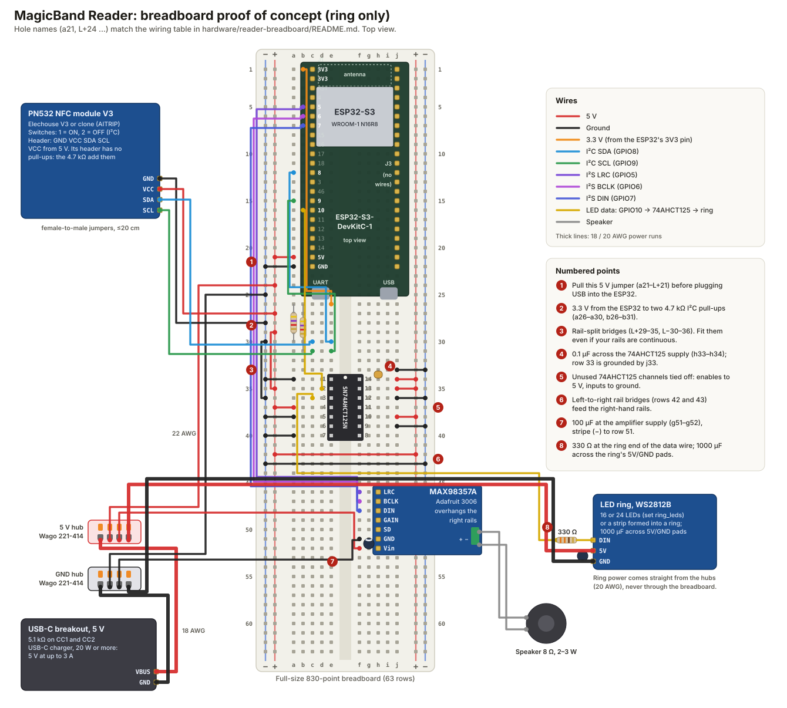

# Build the MagicBand Reader on a breadboard: step by step

Every step, in order, with a check after each stage. Don't skip the
checks: each one catches a mistake before it can damage a part. Hole names
(`c30`, `L+24`) match the [diagram](../../docs/reader-breadboard.svg) and the
[wiring tables](README.md#wiring).

**Rules for the whole build**

- **Unplug the charger before changing any wiring.**
- **USB and the charger never feed the ESP32 together.** Before plugging USB
  into the ESP32, pull the jumper at **a21**. Put it back afterwards.
- **Red is 5 V, black is ground**, everywhere.
- Any check that fails: stop, and fix it before going on. The
  [troubleshooting table](#troubleshooting) lists the usual causes.

**Time:** about 3–4 hours, including soldering the ring.

## Before you start

You need:

| Part | Notes |
|---|---|
| ESP32-S3 N16R8 dev board (DevKitC-1 layout) | Headers fitted. IPEX version: its antenna |
| PN532 NFC module V3 | 4-pin header fitted |
| WS2812B LED ring (here, 35 LEDs) | |
| MAX98357A amplifier kit, 4 Ω 3 W speaker, PH2.0-to-Dupont cable | |
| SN74AHCT125N | |
| Resistors: 2 × 4.7 kΩ, 1 × 470 Ω | Colour bands: 4.7 kΩ yellow-violet-red, 470 Ω yellow-violet-brown |
| Capacitors: 1000 µF, 100 µF (both 10 V or more), 0.1 µF ceramic ("104") | Electrolytics: the stripe marks the **negative** leg |
| CH224K USB-C PD trigger board | |
| 2 × 5-way lever connectors | The power hubs |
| USB-C charger, 20 W or more, and a 3 A USB-C cable | |
| USB-C data cable | For the first install |
| 830-point breadboard, male-to-male jumpers, 4 male-to-female jumpers | |
| 22 AWG stranded wire (red, black, yellow + others), heat shrink | |
| Soldering iron, solder, wire strippers, **multimeter** | |

Full list with alternatives: [shopping list](../shopping-list.md).

**Cutting and finishing wire** (22 AWG stranded):
- **Lever-connector end:** strip **11 mm**, twist the strands tight. Don't
  tin it.
- **Breadboard end:** strip **6 mm**, twist and **tin** it with solder so it
  pushes in cleanly and doesn't fray.
- **Soldered joints:** slide heat shrink on first, solder, then shrink.

## Part 1: prepare the parts

### Step 1. Install the firmware on the bare ESP32

1. IPEX board: press the antenna's connector onto the board's IPEX socket
   until it clicks.
2. Plug the ESP32 into your computer with the data cable, using the port
   labelled **UART** (or **COM**). Nothing else connected.
3. In Chrome or Edge, open the
   [web installer](https://legal-copy7045.github.io/Magic-bHAnds/), click
   **Install the reader**, pick the port, and install.
4. When asked, enter your Wi-Fi name and password.
5. In Home Assistant, a **Discovered** notification appears for
   *MagicBand Reader*. Click **Add**.
6. Open **Settings → Devices & services → ESPHome → the reader →
   Configure** and turn on **Allow the device to perform Home Assistant
   actions**.
7. On the reader's device page, under **Configuration**, set **LED count**
   to the number of LEDs on your ring (**35**). Leave **LED colour order**
   on **GRB** for now.
8. Unplug the USB cable.

✅ **Check:** the device page shows the reader online, and its *Logs* show
it connecting to Wi-Fi (a "PN532 not found" error is expected: it isn't
connected yet).

### Step 2. Set the USB-C PD trigger to 5 V

1. Find the board's voltage table (printed on the board or in its
   listing) and set the DIP switch to **5 V**.
2. Plug the trigger into the charger. **Nothing** on its output.
3. Meter on DC volts, across its **+** and **−** output: **4.75–5.25 V**.
4. Unplug it, plug it back in, and measure again.
5. **Tape over the switch** (or cover it with hot glue).
6. Unplug the charger.

⛔ **Stop if** it reads 9 V or more: the switch is wrong. Anything above
5.5 V destroys every part of the reader.

### Step 3. Make up the power hubs

1. Cut two 25 cm wires, one red and one black. Strip **6 mm** at one end of
   each for the PD trigger's screw terminal and **11 mm** at the other.
2. Red: trigger **+** → first port of the **5 V hub**. Black: trigger **−**
   → first port of the **GND hub**. Tighten the screws, close the levers, and
   tug each wire.
3. Cut a red and a black wire, 15 cm each. Lever end into the next free hub
   port, breadboard end tinned. These will feed the breadboard rails (step 7).
4. Cut another red/black pair, 20 cm each, the same way. These will feed
   the amplifier (step 15).

The ring gets its own pair from the hubs (step 5). That leaves one spare
port on each hub.

### Step 4. Check the breadboard

1. Meter on continuity. Touch one probe to row 1 and the other to row 63
   of each of the four rails (**L−**, **L+**, **R+**, **R−**).
2. A beep means the rail runs the full length. No beep means it's split in
   the middle: the bridges you'll fit in step 7 join it. Fit them either
   way.

### Step 5. Wire the LED ring

The ring's pads are small: use flux, tin the pad and the wire first, then
join them quickly.

1. Identify the pads: **DIN** (or IN), **5V** (VCC), **GND**. Ignore DOUT
   (OUT): nothing connects there.
2. **Power wires:** solder a red wire (40 cm) to **5V** and a black wire (40 cm)
   to **GND**. Strip **11 mm** at the other end for the hubs.
3. **1000 µF:** solder it across the 5V and GND pads (or the wires right at
   them): **stripe (−) to GND**. Keep its legs short and sleeve them with
   heat shrink.
4. **Data wire with the 470 Ω:** cut a yellow wire (40 cm). Slide on heat
   shrink, solder the 470 Ω to one end, and solder the resistor's other leg
   to **DIN**. Shrink the sleeve over the resistor. Tin 6 mm at the far end
   for the breadboard.
5. Tie or hot-glue the three wires to the ring near the pads, so a tug
   can't pull a pad off.

✅ **Check** (meter on continuity or ohms):
- 5V pad to GND pad: **no beep** (a short here would short the supply).
- The yellow wire's free end to DIN: **about 470 Ω**.

### Step 6. Prepare the PN532

1. Set its two switches for I²C: **1 = ON, 2 = OFF**.
2. Plug 4 male-to-female jumpers onto its header: **GND, VCC, SDA, SCL**
   (black, red, blue, green).

You'll check the module itself in step 10, before its data wires go near
the ESP32.

## Part 2: build and test, stage by stage

### Stage 1: ESP32 and power

**Step 7. Power to the breadboard**
1. Push the ESP32 in: header **J1 into c1–c22**, **J3 into j1–j22**,
   antenna towards row 1, USB ports towards row 25. Press evenly; it's a
   tight fit.
2. Rail bridges (jumpers): **L+29 → L+35**, **L−30 → L−36**,
   **L+42 → R+42**, **L−43 → R−43**.
3. Hub feeds from step 3: red → **L+24**, black → **L−25**.
4. ESP32 power: **a21 → L+21** (5 V; the one you pull before USB) and
   **a22 → L−22** (GND).

**Step 8. First power-up**
1. Plug in the charger.
2. Measure: hub 5 V to GND **4.75–5.25 V**; ESP32 **5V** pin (a21) to GND
   the same; ESP32 **3V3** pin (a1) to GND **3.2–3.4 V**.
3. Home Assistant → the reader → *Logs*: it boots and connects to Wi-Fi.

⛔ **Stop if** the voltage is below 4.75 V, the charger cuts out, or
anything gets warm. Unplug the charger.

### Stage 2: NFC reader

**Step 9. I²C pull-ups and wires** (charger unplugged)
1. 4.7 kΩ from **a26 to a30** and 4.7 kΩ from **b26 to b31** (lying flat).
2. Jumpers: **b1 → e26** (3.3 V to the pull-ups), **a12 → e30** (GPIO8, SDA),
   **a15 → e31** (GPIO9, SCL).

**Step 10. Connect the PN532**
1. **Clone check first.** Plug in only its **VCC → L+27** and
   **GND → L−28** jumpers, leaving SDA and SCL loose. Plug in the charger
   and measure the loose SDA and SCL jumper ends to GND:
   - **Below 3.6 V** (typically 2.5–3.3 V, or near 0 V): OK.
   - **Near 5 V: stop.** That clone pulls SDA/SCL up to 5 V and would
     damage the ESP32. Use a different module.
2. Unplug the charger. Plug in **SDA → c30** and **SCL → c31**.
3. Plug in the charger. Measure: PN532 VCC to GND 4.75–5.25 V; SDA (c30)
   and SCL (c31) to GND **3.2–3.4 V**.
4. *Logs*: the I²C scan finds a device at **0x24**, and the PN532 reports
   its firmware version with no errors.
5. Tap a MagicBand on the PN532: its ID appears in the log, and in Home
   Assistant under **Settings → Tags**. The ring isn't connected yet, so
   nothing lights.

⛔ **Stop if** there's no device at 0x24: check the switches (1 ON, 2 OFF)
and that SDA and SCL aren't swapped.

### Stage 3: level shifter and ring

**Step 11. Fit the 74AHCT125's wiring first, without the chip** (charger
unplugged)
1. Tie-offs: **a34 → L−34**, **a37 → L+37**, **a38 → L−38**, **a40 → L−40**,
   **j33 → R−33**, **j34 → R+34**, **j35 → R+35**, **j36 → R−36**,
   **j38 → R+38**, **j39 → R−39**.
2. 0.1 µF ceramic from **h33 to h34**.
3. LED data in: **b16 → d35** (GPIO10).
4. ✅ **Check** with the meter on continuity: e34, a38, j36 and j39 to GND
   beep; j34, a37, j35 and j38 to 5 V beep; 5 V to GND does **not** beep.

**Step 12. Fit the chip**
1. Notch (or dot) towards **row 1**, pin 1 in **e34**: pins 1–7 run down
   column e (rows 34–40), pins 14–8 down column f. Straighten the legs on a
   table first so they line up.

**Step 13. Connect the ring**
1. Ring **GND** wire into the GND hub, then **5V** into the 5 V hub.
2. Ring **data** wire (with its 470 Ω) into **c36**.
3. Plug in the charger. The ring may flash briefly at power-up; that's
   normal.
4. Measure IC pin 14 (j34) to pin 7 (a40): **4.75–5.25 V**.
5. In Home Assistant, the ring should show the soft white **idle glow**.
   Turn on the **Ring** light and try red, green and blue at 100 %.

✅ **Check:** all 35 LEDs light, in the right colours.
- Red shows as green (or the reverse): set **LED colour order** to **RGB**.
- Only some LEDs light: check **LED count**.
- Flicker or random colours: check the data path (b16 → d35, c36 → 470 Ω →
  DIN), the 74AHCT125's orientation, and that every ground meets at the
  GND hub.

### Stage 4: amplifier and speaker

**Step 14. I²S wires** (charger unplugged)
1. Jumpers: **b5 → f46** (GPIO5, LRC), **b6 → f47** (GPIO6, BCLK),
   **b7 → f48** (GPIO7, DIN).

**Step 15. Amplifier power on the board**
1. Hub feeds from step 3: red → **f52**, black → **f51**.
2. 100 µF: negative leg (stripe) in **g51**, positive in **g52**.

**Step 16. Plug in the amplifier**
1. Plug the PH2.0 cable into the amplifier's 5-pin socket.
2. Read the **labels printed on the amplifier** next to its socket, and
   follow each wire to its Dupont end. Plug them in: **LRC → h46**,
   **BCLK → h47**, **DIN → h48**, **GND → h51**, **VIN → h52**. If the ends
   are female, push a short male-to-male jumper into each first.
3. Plug the speaker into the amplifier's 2-pin PH2.0 socket.

**Step 17. Test the sound**
1. Plug in the charger. Measure VIN to GND at h52/h51: **4.75–5.25 V**.
2. The **start-up sound** plays.
3. On the device page, press **Test welcome**: the ring spins, turns green,
   and the tap-in sound plays.

⛔ **Stop if** there's no sound: check LRC, BCLK and DIN aren't swapped,
and VIN/GND aren't reversed. If the ESP32 restarts when a sound plays, the
supply is dipping: re-check the hub wiring.

### Stage 5: everything at once

**Step 18. Load test**
1. Set **Ring** to white at 100 % and the **Speaker** volume to 100 %.
2. Press **Test welcome** repeatedly for a minute, then tap bands.
3. Measure the hub voltage while that runs: **at least 4.75 V**.
4. Afterwards: the reader's *Uptime* hasn't reset, and nothing is more than
   barely warm (power wires, hubs, PD trigger, 74AHCT125).

⛔ **Stop if** the voltage dips below 4.75 V, the charger cuts out, the
ESP32 restarts, or anything is hot. Lower **LED brightness** and check the
power wiring.

Set the **Ring** light back off: the reader returns to its idle glow after
the next tap.

## Part 3: set it up in Home Assistant

### Step 19. Tune the ring

On the device page, under **Configuration**:

| Setting | What it does |
|---|---|
| **LED count** | LEDs on your ring (35) |
| **LED colour order** | GRB for most rings; RGB if red and green are swapped |
| **LED brightness** | Scales everything the ring shows (5–100 %) |
| **Idle glow** | The white glow between taps (0 = off) |
| **Sound** / speaker volume | Turn sounds on or off; set the volume on the *Speaker* entity |
| **Light up MagicBand+** | Whether a MagicBand+ lights up green on a welcome |

### Step 20. Bands and people

1. Install the [MagicBand integration](../../docs/integration.md) from
   HACS, restart Home Assistant, and add **MagicBand** under **Settings →
   Devices & services**.
2. Tap each band once. Under **Settings → Tags**, give each one a name.
3. Allow your bands, either in the MagicBand integration (people and their
   bands) or on the reader: tap a band, then press **Allow last band**.
4. **Response mode** chooses who's welcomed: *Known bands only* (default),
   *Welcome every band*, or *Ask Home Assistant*.

### Step 21. Final checks

Run the [checklist in hardware/README.md](../README.md#checking-a-build-works),
and note anything odd (read range, volume, LED behaviour) for the next
build.

## Troubleshooting

| Symptom | Likely cause |
|---|---|
| Nothing powers up | PD trigger not at 5 V or the charger is under 20 W; a hub wire not pushed fully in; a21/a22 missing |
| ESP32 resets when the ring or sound starts | Supply dipping: charger under 20 W, a thin or long power wire, or the ring/amplifier powered through the breadboard instead of the hubs |
| "PN532 not found" | Switches not on I²C (1 ON, 2 OFF); SDA/SCL swapped; pull-ups missing; PN532 VCC not on 5 V |
| Band not read | Band too far: hold it flat on the antenna; no metal between them |
| Ring dark | Data wire on DOUT instead of DIN; 74AHCT125 in backwards; a21 jumper out; LED count set to 0 |
| Ring flickers or shows random colours | Grounds not common; 470 Ω missing or at the wrong end; data wire too long or run away from the ring's power pair |
| Red and green swapped | Set **LED colour order** to RGB |
| Only part of the ring lights | **LED count** too low |
| No sound | LRC/BCLK/DIN swapped; VIN/GND reversed; speaker not plugged in; **Sound** switched off |
| Sound distorts at high volume | Supply dipping: check the amplifier's wires go straight to the hubs and the 100 µF is fitted |
| Can't install over USB | Wrong port: use the one labelled UART/COM; use a data (not charge-only) cable; pull a21 first |
