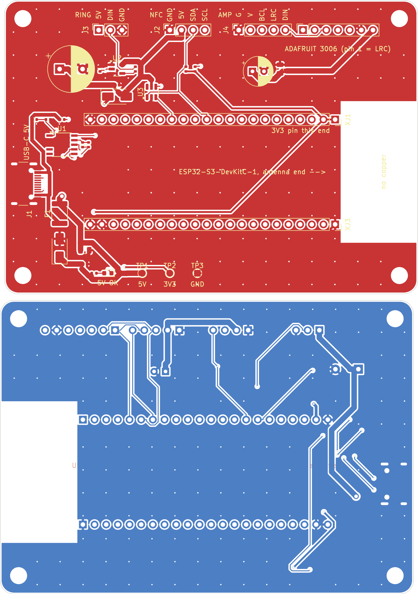

# MagicBand Reader carrier board (KiCad)

Build option 4 of [the ways to build the reader](../README.md).

A 90 × 64 mm, 2-layer "brains" board for the [MagicBand Reader](../../docs/reader.md),
with four M3 holes, sized for a 4.92 in (125 mm) box. It replaces the
breadboard, the power hubs, the interface board and the separate USB-C PD
trigger. The parts you already have plug in:

- the **ESP32-S3-DevKitC-1 (N16R8)** dev board, into two 22-pin sockets;
- the **MAX98357A amplifier kit**, by its own 5-wire cable (or an Adafruit
  3006 breakout straight into a 7-pin socket); the speaker plugs into the
  amplifier as before;
- the **LED ring** and the **PN532 NFC board**, on leads, so they can go
  wherever the housing needs them.

Every lead keeps the cable it uses on the breadboard: each plugs into a
2.54 mm female header wired in **that cable's own pin order**, so nothing is
re-crimped or crossed over.



[Schematic (PDF)](docs/schematic.pdf) · [Front](docs/front.svg) · [Back](docs/back.svg) · [DRC report](fab/drc.rpt)

> **Status: routed, design rules pass, not yet built.** Every net in the
> schematic matches the board pin for pin, the dev-board sockets follow
> Espressif's DevKitC-1 pinout, and the build checks every power track's
> width in the routed copper (below). Treat the first order as a prototype: get 5
> boards, power one up without the dev board first (below), and keep the
> compact build working until a board has been proven.

## What's on it

| | Part | Notes |
|---|---|---|
| J1 | USB-C (power only) | On the left edge |
| U1 | **CH224A** USB PD controller (or a CH224K) | Asks the charger for **5 V**, and nothing else: CFG1 is tied high through two 200 kΩ resistors side by side (R3, R9: either alone still holds it), so there's no switch to knock to 20 V. The CH224A is WCH's pin-compatible upgrade of the CH224K and the one JLCPCB stocks; wired per its datasheet (V2.1, 6.1.2) with **R1 and R2 = 0 Ω**. For a CH224K, fit **R1 = 1 kΩ and R2 = 10 kΩ** instead (6.2). D+/D− are left open (power only: the request goes over CC) |
| F1 | 3.5 A resettable fuse (1812, SMD1812P350TF/16) | Between USB-C and everything else. Sized for a warm box: see below |
| D2 | SMAJ5.0A TVS | Clamps spikes on the 5 V rail |
| D1 | Green LED, "5V OK" | Lights when the charger has agreed 5 V (the CH224A's PG) |
| D3 | SS34 Schottky | 5 V to the dev board. The board powers the ESP32, but the dev board's own USB can't power the LEDs and amplifier, so there's **no 5 V wire to pull** before using USB. (D3 stops the dev board's USB feeding the 5 V rail. What stops the charger feeding a computer through the dev board's USB port is the dev board's own diodes: check yours once, under First power-up) |
| U2 | 74AHCT1G125 | 3.3 V → 5 V LED data, then **470 Ω** (R7) |
| U3 | SRV05-4 | ESD clamp on the lines that leave the box: SDA, SCL, LED data |
| R5, R6 | 4.7 kΩ | I²C pull-ups to 3.3 V |
| R8 | 10 kΩ | Holds the LED data input low while the ESP32 boots (its pin floats until then), so the ring doesn't flash at power-up |
| C5 | 1000 µF 10 V | LED ring supply, by the ring connector |
| C6, C7 | 100 µF 16 V, 10 µF | Amplifier supply, by its header |
| TP1–TP3 | Test pads | 5 V, 3.3 V, GND |

GPIOs are the reader firmware's: I²S LRC 5, BCLK 6, DIN 7; I²C SDA 8, SCL 9;
LEDs 10. The firmware doesn't change: install the standard reader from the
[web installer](https://legal-copy7045.github.io/Magic-bHAnds/).

## Connectors and leads

| | Header (2.54 mm female) | Pins, left to right (1 = square pad) | Plug in | Lead length |
|---|---|---|---|---|
| J3 | 1×3 | **5V, DIN, GND** | The LED ring's 3-pin plug with its jumper wires: **red, green, black**. Use **22 AWG** for 5V and GND (the ring can draw 1.4 A), not thin jumper wire | Up to about 1 m |
| J2 | 1×4 | **GND, 5V, SDA, SCL** | The PN532's 4-wire Dupont cable, in the PN532's own order (GND, VCC, SDA, SCL). PN532 switches: 1 ON, 2 OFF (I²C) | Up to about 50 cm |
| J4 | 1×5 | **G, V, BCL, LRC, DIN** | The amplifier kit's cable, in the order printed by its socket. On the tested kit: **black G, red V, blue BCL, green LRC, yellow DIN**, black on the square pad | As supplied (about 20 cm) |
| J5 | 1×7 | LRC, BCLK, DIN, GAIN, SD, GND, Vin | An Adafruit 3006, *instead of* the kit on J4. Fit it parts-side up, so it stands out past the board's top edge (by about 10 mm) and not over the dev board | — |
| XJ1, XJ3 | 2 × 1×22, 22.86 mm apart | DevKitC-1 J1 and J3 | The dev board, **antenna end over the copper-free strip** (pin 1 on the right) | — |

The cables' male ends push into the headers the same way they push into a
breadboard. Once everything works, a dab of hot glue along each row keeps
them from working loose in the box. Labels on the board name every pin.

## Power tracks

### Current budget

Everything runs from the one USB-C input, so the worst case adds every
maximum at once (the same budget as the [shopping list](../shopping-list.md#current-budget-with-these-parts)):

| Load | Worst case |
|---|---|
| LED ring at full white | 1.44 A |
| Amplifier (MAX98357A into 4 Ω, full volume) | 0.65 A |
| Dev board (ESP32-S3, Wi-Fi transmit peak; *estimate*) | 0.50 A, through D3 |
| PN532 (*estimate*) | 0.15 A |
| Level shifter, pull-ups, LED | 0.01 A |
| **Total through USB-C, the fuse and the shared 5 V track** | **≈ 2.75 A**, under the charger's 3 A |

**The ring is capped by the firmware, not by its size.** 1.44 A is 24 RGB
LEDs × 60 mA. With more LEDs the reader scales its output down so full white
stays at about 1.44 A (24 ÷ LED count: a 35-LED ring runs at up to 68 %; an
RGBW ring is capped at 18 LEDs × 80 mA). That only works if the reader's
**LED count** setting matches the ring: set it before the first full-white
test. Without the cap, 35 LEDs × 60 mA would be 2.1 A for the ring and about
3.4 A in all, over a 3 A charger.

In normal use the reader draws about 0.3 A idle and about 1.4 A during a
welcome. The firmware's ring cap keeps the load inside the budget, and the
**charger's own 3 A limit is the short-circuit protection**: a 3.5 A fuse
can't trip on a 3 A supply. The fuse is a backstop for a supply that can
give more.

**Fuse and temperature.** A polyfuse's hold current falls as it gets warmer,
so it's sized for the inside of a closed box, not a 25 °C bench. From the
Ruilon SMD1812 datasheet (hold current, amps):

| | 25 °C | 40 °C | 50 °C | 60 °C | Trips at (25 °C) | Max voltage |
|---|---|---|---|---|---|---|
| SMD1812P300TF (3 A) | 3.00 | 2.55 | 2.28 | 2.01 | 5 A | 8 V |
| **SMD1812P350TF/16 (3.5 A, fitted)** | 3.50 | **2.98** | 2.66 | 2.35 | 6 A | 16 V |

The 3 A part would hold only 2.55 A at 40 °C, under the 2.75 A worst case.
The 3.5 A part holds it up to about 45 °C inside the box; the welcome load
(about 1.4 A) is far below either. Hold current is for an hour at that
current, so the full worst case, which lasts seconds, has more margin still.
It's the same 1812 size. The 16 V version is fitted because the plain
SMD1812P350TF is rated only 6 V, too close to a 5 V rail and the TVS's
clamp. If the box gets hotter than about 45 °C, or the ring is left on full
white for long, lower the ring's brightness rather than fit a bigger fuse.

### Track widths

| Net | Track | Carries (worst case) |
|---|---|---|
| VBUS (USB-C → fuse) | 0.8 mm | Everything, ≈ 2.75 A |
| +5V (fuse → ring, amplifier, NFC, and D3 to the dev board) | 1.2 mm | Up to ≈ 2.75 A by the fuse, less further along |
| ESP_5V (D3 → dev board) | 0.6 mm | ≤ 0.5 A |
| +3V3 | 0.4 mm | Pull-ups only |
| GND | 0.5 mm tracks plus solid pours on both sides | |

**Standard 1 oz copper.** By IPC-2221 (outer layer), 1.2 mm at 1 oz carries
about 2.7 A for a 10 °C rise and 0.8 mm about 2.0 A (2.8 A for 20 °C): the
full worst case (≈ 2.75 A, everything at maximum at once, which lasts seconds
and which the firmware's ring cap keeps rare) warms the 5 V track by about
10 °C, and the short 0.8 mm run from the socket to the fuse by about 20 °C.
At full load the board itself drops about 0.15–0.2 V between the socket and
the headers (mostly the fuse); the cable adds more. 2 oz copper would halve
the track's share, but at
2 oz JLCPCB needs 0.20 mm of solder mask between pads, exactly the gap
between the USB-C pins, and thicker copper makes the hand-soldered ground
pins harder to heat, so 1 oz is the better trade.

The only narrower pieces are necks into pads that are themselves narrower
than the track, no narrower than that pad, each under 3 mm: the two USB-C VBUS pins (0.6 mm, too
close together for more) and, depending on how the router lays it out, the
SRV05-4's 5 V pin or the 5V OK LED's resistor (a few mA). `tools/check_widths.py` measures the routed copper,
lists every neck, and fails the build on any other power track narrower than
this table. It also traces the copper from the fuse to every load (the ring,
amplifier and NFC headers, their capacitors and the dev board's diode) and
fails unless each is reached at full width, so a neck can only ever feed a
small part, never sit in the path to a load. It also checks vias: the 5 V path changes layer only at the
through-hole pins, and any via on VBUS or +5V must have a 0.8 mm drill, so a
via barrel is never the thinnest copper in the path.

### Ground and the speaker

On the breadboard, the sound crackled on the charger until the ESP32 had its
own ground wire to the amplifier: otherwise the I²S signals' ground return
ran through the power hub. The board does this in copper: ground pours fill
both sides (stitched together with vias), the dev board's four GND pins and
the amplifier header's G pin all join them directly, and the I²S tracks run
over that ground all the way. There's no jumper to add. If it ever crackles,
check the amplifier lead's G wire first.

## Compared with the tested build

The circuit is the [compact build](../reader-compact/build.md) that was
built and tested, connection for connection: GPIO 5/6/7 to the amplifier's
LRC/BCLK/DIN, GPIO 8/9 to the PN532's SDA/SCL with 4.7 kΩ pull-ups to 3.3 V,
GPIO 10 through a 74AHCT125 gate (enable low, 5 V supply, 0.1 µF) and 470 Ω
to the ring's DIN, the PN532 on 5 V, 1000 µF at the ring's supply and 100 µF
at the amplifier's, and a CH224 PD chip set to 5 V. What the board adds:

| Added | Why | Effect on the tested circuit |
|---|---|---|
| D3 (Schottky) in the dev board's 5 V feed | Replaces "unclip the ESP32's 5 V wire before using USB" | The dev board gets about 4.6–4.7 V, as it does from its own USB port (how the build was first tested) |
| F1 fuse, D2 TVS | Protection | Under 0.1 V drop at full load |
| U3 ESD clamps on SDA, SCL, LED data | The leads leave the board | A few pF on each line |
| R8 10 kΩ pull-down on GPIO 10 | No ring flash while the ESP32 boots | None once it's running |
| C2, C3, C7 | Extra decoupling | None |
| Ground pours | Replace the ground hub and the two ground jumpers that stopped the crackle | Lower-resistance version of the same thing |

The PD chip is a CH224A on the board; the tested build used a CH224K
trigger module. Both ask for 5 V; the 1000 µF sits behind either.

## Fitting it in the box

- The USB-C socket is on the **left edge**. For a cable coming up through
  the stand, drill the box floor near that edge and leave about 25 mm for the
  plug and the bend, or use a right-angle USB-C cable.
- The leads to the Mickey head plug in along the **top edge**.
- The dev board's antenna end (right) should face away from metal; nothing
  in the box should sit over it. On the board, copper stops just past the
  sockets' pin 1: the antenna sticks out about 7.7 mm past pin 1 (Espressif's
  DevKitC-1 v1.1 drawing), and has no copper under any of it.
- Height: about 25 mm with the dev board in its sockets (the 1000 µF is
  about 20 mm tall). Use M3 standoffs of 5 mm or more under the board.

## Ordering (JLCPCB)

1. Upload **`fab/magicband-carrier-gerbers.zip`** at jlcpcb.com: 2 layers,
   1.6 mm, any colour except black or white (their solder mask needs more
   room between the USB-C pins than there is), 1 oz copper (the default; see
   Power tracks). The zip
   has separate drill files for plated and non-plated holes.
2. Turn on **PCB Assembly**, top side, and upload **`fab/bom.csv`** and
   **`fab/cpl.csv`**. They list only the small surface-mount parts.
   `cpl.csv` already has JLCPCB's angles for U1, U2 and U3 (its models of those
   parts sit at a different angle from KiCad's). For any other assembler
   (PCBWay and so on) upload **`fab/cpl-kicad.csv`** instead: KiCad's own angles.
3. Every part has an LCSC number, checked in stock at JLCPCB on 21 Nov 2026
   (the fewest: the fuse, 250, and the CH224A, about 500). If one has run out, pick the same MPN
   or an equivalent in the parts search; keep R1/R2 matched to the chip
   (0 Ω for a CH224A, 1 kΩ/10 kΩ for a CH224K).
4. In the placement preview, check every part that can go on the wrong way
   round (with `cpl.csv` they should already be right), and rotate any that's off:
   - **U1** (CH224A), **U2**, **U3**: the chip's pin-1 dot at the corner the
     board marks. **U3 matters most:** turned half round it still fits its
     pads, and shorts the 5 V rail.
   - **D1, D2, D3**: the part's cathode bar at the marked end (the board
     doesn't print their names: find them by name in JLCPCB's preview). D2
     reversed shorts the 5 V rail; D3 reversed leaves the dev board unpowered.
   - **J1** (USB-C): its opening at the board edge, and its pins sitting on
     their pads.

**You solder** (through-hole, all on the top side): the 2.54 mm female
headers (two 1×22, one each of 1×3, 1×4 and 1×5; the 1×7 only if you use an
Adafruit 3006) and the 1000 µF and 100 µF capacitors (stripe = minus, away
from the square pad). Nothing else. The ground pins join the ground copper through
thermal spokes, so they heat up like the others.

**When the boards arrive, look at the USB-C socket's four metal tabs** (the
legs that go through the slots). They take the force of every plug-in. If
any isn't soldered, solder it yourself before plugging a cable in.

**The dev board goes in one way only:** antenna end to the right, over the
bare strip, with its 3V3 pins at the end marked "3V3 pin this end". Fitted
the other way round it would be damaged.

## Before you order: physical checks

- **Charger and cable:** a USB-C PD charger that offers **5 V 3 A** (most of
  20 W and up do), with a cable rated 3 A. Test with the charger and cable
  you'll actually use.
- **Capacitors:** check the 1000 µF you'll fit is 10 mm across with 5 mm lead
  spacing, 10 V or more, and short enough for the box (about 20 mm or less);
  the 100 µF 6.3 mm across, 2.5 mm spacing. Minus stripe away from the square
  pad.

## First power-up

1. **No dev board, no leads: do this for every board, before anything is
   plugged into it.** Plug in the USB-C charger: the **5V OK** LED
   lights. Measure **TP1 (5V) to TP3 (GND): 4.75–5.25 V**. If it reads
   more than 5.5 V, the LED flickers, or anything gets hot: unplug at once.
   Two resistors (R3, R9) hold the chip's request at 5 V; if both were
   missing it could ask the charger for up to 20 V. (On a plain 5 V
   USB-C supply that doesn't speak PD the LED may stay off; the board still
   works.)
2. Unplug. Fit the dev board (antenna end right). Plug in: the dev board's
   LED lights, **TP2 (3V3) reads 3.2–3.4 V**, and still does once the reader
   is on Wi-Fi (the dev board gets about 4.6 V through D3, the same as it
   gets from its own USB port).
   **Once, for your dev board:** with the reader running from the charger,
   plug a USB-A-to-C cable into one of the dev board's USB ports, leaving
   the USB-A end free, and measure between the two outer contacts of the
   USB-A plug. It should read **about 0 V** (repeat on the other port).
   Espressif's board has diodes that guarantee this. If yours shows about
   5 V, never plug its USB into a computer while the charger is in.
3. **PN532 check, before its data lines meet the ESP32** (as on the tested
   build): dev board out, PN532 plugged into J2, charger in. Measure socket
   XJ1 pins 12 and 15 (SDA, SCL; count from the antenna end) to GND: both
   **under 3.6 V**. Near 5 V: stop, that module would damage the ESP32.
   Then unplug, fit the dev board, and add the amplifier and the ring one
   at a time, running
   [the checks for every build](../README.md#checking-a-build-works).
   On the dev board's USB alone (no charger) the ring, NFC and sound are
   off and the log shows I²C errors: that's expected.
4. **Full-load test.** Check the reader's **LED count** matches the ring.
   Set the ring to full white at full brightness and play
   a sound at full volume. Measure 5 V **at the ring and amplifier headers**
   (not only TP1): no more than about 0.3 V below TP1, and above 4.5 V. The fuse and tracks should
   be no more than warm after a few minutes.
5. **Plug-in test.** The board has about 1,100 µF on its 5 V rail and no
   soft start, so the charger sees a burst of current at plug-in (the
   breadboard, with the same capacitors, was fine). With everything
   connected, unplug and replug the charger ten times: the reader should
   start every time. If your charger ever fails to start it, use another.

## How it's made

Everything is generated from one parts list (`tools/netlist.py`):
`make_schematic.py` writes the schematic, `make_pcb.py` places the parts,
Freerouting 1.9.0 routes it (`export_dsn.py` / `import_ses.py`, with the
power nets moved into their own wide-track classes in the DSN and ground
stitched between the pours), `check_widths.py` checks the routed power
widths, and `make_fab.py` writes the JLCPCB files. `tools/build.sh` runs it
all, including the design-rule check:

```
FREEROUTING=/path/to/freerouting-1.9.0.jar tools/build.sh
```

The CH224A/CH224K has no KiCad library part; its symbol and footprint (ESSOP-10 with
the exposed pad, its only ground) are in `tools/lib/`, with the USB-C
footprint (`make_usb_fp.py` makes it).

**USB-C footprint, checked against HRO's drawing** (TYPE-C-31-M-12, the
recommended PCB layout LCSC serves for C165948, which allows ±0.05 mm):

| | HRO drawing | This board |
|---|---|---|
| Pin pitch, pad widths, inner pads | 0.50, 0.30 / 0.60 mm | Same |
| Peg holes | 2 × Ø0.60, 5.78 mm apart | Same |
| Shell slots | 8.65 mm apart; drills 0.60 × 1.70 at the back, 0.60 × 1.40 at the front; pads 0.90 mm wide | Same drills (KiCad's front slots were 1.20 mm long, which could pinch the shell's tabs); pads 1.12 mm wide, for the 0.26 mm copper ring JLCPCB needs (HRO's 0.90 would leave 0.15 mm) |
| Outer pads (GND, VBUS) | ±3.20 / ±2.40 mm | ±3.25 / ±2.45 (KiCad's): within the 0.05 mm tolerance, and the room the CC2 track needs |
| Signal pad length | 1.14 mm, 0.50 mm behind the pegs | 1.45 mm, 0.72 mm behind (KiCad's): HRO's leave 0.20 mm to the peg holes, under the 0.25 mm hole clearance; KiCad's cover all but the front 0.22 mm of HRO's |
| Board edge | 5.79 mm in front of the pegs, shell ~0.5 mm past it | Same, so a plug's moulded grip (taller than the socket) can't hit the board edge before it seats |

It also drops the three silkscreen lines that would print off the board
edge. `fp-lib-table` points the DRC at
those and at KiCad's own footprints, so it checks every footprint against its
library too. The build stops unless the DRC report is clean (0 violations,
0 unconnected pads) and every power track passes `check_widths.py`.
