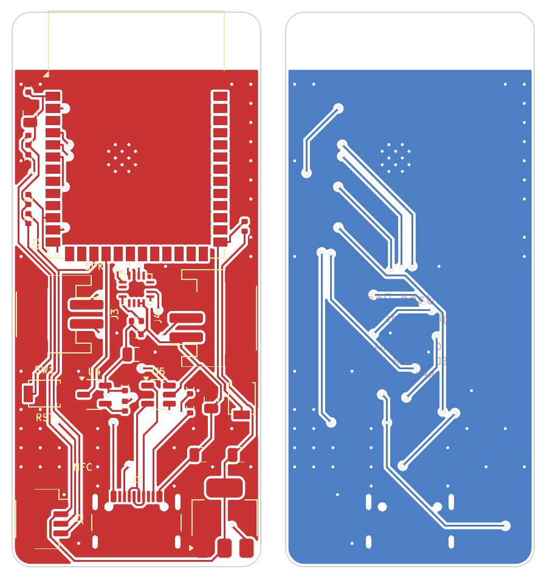

# MagicBand Reader PCB (KiCad)

Build option 4 of [the ways to build the reader](../README.md).

A 26 × 58 mm, 2-layer board for the [MagicBand Reader](../../docs/reader.md).
It replaces the dev board, amplifier module, level shifter and breadboard.
The NFC reader, speaker and LEDs plug in on leads.

[Schematic (PDF)](docs/schematic.pdf) · [Front](docs/front.svg) · [Back](docs/back.svg) · [DRC report](fab/drc.rpt)

> **Status: routed, design rules pass, ready to order, but not yet built or
> tested.** Treat the first order as a prototype: get 5 boards, check them
> before connecting the LEDs, and keep the dev-board version working until
> one has been proven.

## What's on it

| | Part | Notes |
|---|---|---|
| U1 | ESP32-S3-WROOM-1-**N16R8** | Same chip, flash and PSRAM as the dev board. Antenna along the top edge, with no copper under it |
| J1 | USB-C (GCT USB4105) | Power and flashing (native USB), 5.1 kΩ CC resistors, USBLC6 ESD protection |
| U2 | AMS1117-3.3 | 3.3 V for the ESP32 and the NFC reader |
| U3 | MAX98357A | I2S amplifier, mono, 9 dB gain |
| U4 | 74AHCT1G125 | 3.3 V → 5 V LED data, with a 330 Ω series resistor |
| SW1, SW2 | RESET, BOOT | |

GPIOs match the reader firmware: I2S LRCLK 5, BCLK 6, DOUT 7; I2C SDA 8,
SCL 9; LEDs 10.

## Connectors (leads)

| | Connector | Pins | Goes to |
|---|---|---|---|
| J2 | JST **SH** 1.0 mm, 4-pin, left edge | GND, 3V3, SDA, SCL | PN532 (I2C mode). Qwiic / STEMMA QT order, so a Qwiic-to-Dupont lead fits a PN532 module's header |
| J3 | JST **PH** 2.0 mm, 2-pin, left edge | SPK+, SPK− | 4–8 Ω speaker, 3 W max |
| J4 | JST **PH** 2.0 mm, 3-pin, right edge | 5V, DATA, GND | LED ring DIN; chain the Mickey head off the ring's DOUT |

All connectors are side-entry, so leads leave flat along the board.

## Power

Everything runs from the USB-C port, LEDs included. Use a USB-C charger
that offers **5 V 3 A** (most do). 36 LEDs at full white draw ~2 A, and the
reader's default brightness is well below that. A plain USB-A port gives
0.5–1.5 A, which is fine for the board but not for bright LEDs.

## Firmware

Use **Reader on the custom PCB** in the web installer, built from
[`esphome/magicband-reader-pcb.yaml`](../../esphome/magicband-reader-pcb.yaml).
It's the standard reader with logs and Wi-Fi setup on the ESP32-S3's native
USB port (the board has no USB-serial chip), and it updates on its own
channel. Plug in USB-C, click install; if the board isn't detected, hold
**BOOT**, tap **RESET**, release **BOOT**, and try again.

Once it's running, go through the checks in
[hardware/README.md](../README.md#checking-a-build-works).

## How it's made

Everything is generated by scripts in `tools/` from one parts list
(`tools/netlist.py`), so the schematic and board can't disagree. The
schematic's netlist was exported from KiCad and checked against it.

- `make_schematic.py`: the schematic, with every pin labelled by net name.
- `make_pcb.py`: footprints, placement, outline, ground pours.
- `export_dsn.py` → **Freerouting 1.9.0** → `import_ses.py`: autorouting.
  Ground is routed as tracks too, then the ground pours go back on and
  stitching vias tie the two sides together.
- `make_fab.py`: the JLCPCB BOM and placement file.
- `build.sh` runs it all, including the design-rule check and Gerber export.

The design-rule check (`fab/drc.rpt`) has **no errors and no unconnected
pads**. The remaining entries are notices that the stock KiCad libraries
aren't configured on the build machine, and silkscreen warnings where the
module outline meets the board edge (the fab trims these).

Net classes: +5V and +3V3 0.4 mm, GND and speaker 0.3 mm, USB 0.25 mm,
signals 0.2 mm. The strip under the antenna has no copper on either side.

To change the design, edit `netlist.py` or `make_pcb.py` and run
`tools/build.sh`, or open `magicband-reader.kicad_pro` in KiCad and edit it
directly (then stop using the scripts, which would overwrite your changes).

## Ordering (JLCPCB)

1. Upload **`fab/magicband-reader-gerbers.zip`** (Gerbers and drill file)
   at jlcpcb.com. 2 layers, 1.6 mm, any colour. Turn on **PCB Assembly**,
   top side.
3. Upload `fab/bom.csv` and `fab/cpl.csv`. Parts with an LCSC number match
   automatically. Search for the others by MPN (USB4105-GF-A, the JST SH/PH
   connectors, B3U-1000P, SN74AHCT1G125DBVR) or pick equivalents. **Check
   every match and rotation in JLC's preview**, especially U1, U3 and J1.

4. Tick "Confirm parts placement" so JLC's engineers check rotations too.

Design rules: 0.2 mm minimum tracks, 0.15 mm minimum clearance (0.2 mm
between different nets in practice), 0.6/0.3 mm vias, 0.3 mm smallest
drill. All within JLCPCB's standard 2-layer process. The USB-C socket's
plastic pegs sit 0.19 mm from a pad in GCT's own footprint, which is normal
for that part.
