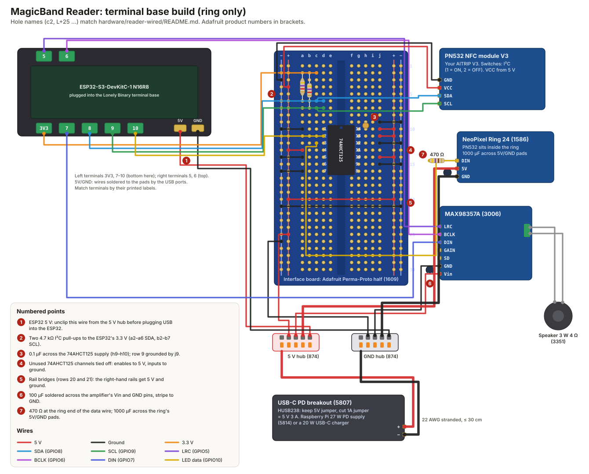
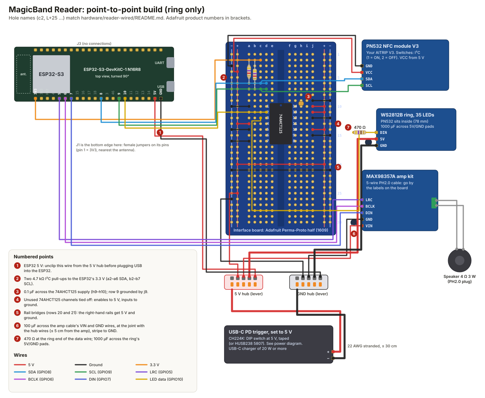
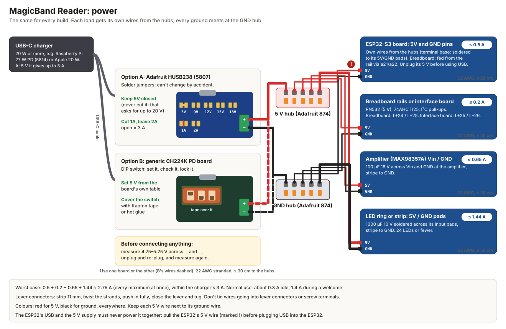
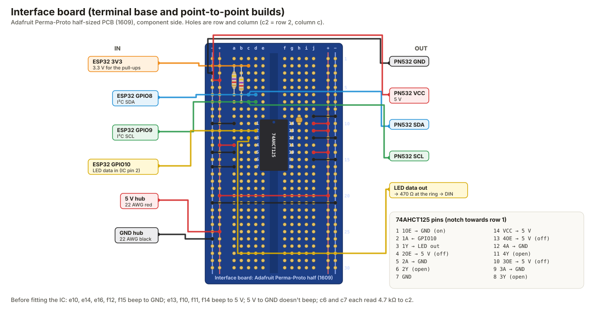

# MagicBand Reader: terminal base and point-to-point builds

Two more compact ways to build the
[breadboard proof of concept](../reader-breadboard/README.md), with the
same parts, connections and power:

- **Terminal base:** the ESP32-S3 board plugs into a Lonely Binary
  pluggable terminal-block base, and wires go into its push-in terminals.
- **Point-to-point:** female Dupont jumpers go straight onto the ESP32-S3
  board's header pins.

Everything else is shared: a small **interface board** for the level
shifter and I²C pull-ups, two lever-connector **power hubs**, and the ring,
amplifier and PN532 wired to them. Parts: the
[shopping list](../shopping-list.md).

| Terminal base | Point-to-point |
|---|---|
|  |  |

**Status:** reviewed, **not yet built**. Build and test the breadboard
version first. The component review, current budget and the reasons behind
each choice are in the [breadboard spec](../reader-breadboard/README.md),
and apply here unchanged.

## Power

- **Supply:** a **USB-C charger of 20 W or more** (Apple 20 W, a laptop
  charger and so on) and a USB-C cable rated for 3 A or more. At 5 V, USB-C
  gives up to 3 A; the reader needs at most about 2.75 A with the 24-LED
  ring and the 4 Ω speaker.
- **USB-C PD board:** the Adafruit HUSB238 (product 5807) with the **5V
  jumper kept closed** and the **1A jumper cut** (5 V 3 A), or a generic
  CH224K board with its switch set to 5 V and taped down. Never select
  anything above 5 V. Details: [breadboard spec](../reader-breadboard/README.md#supply)
  and the [generic parts](../shopping-list.md#generic-alternatives).
- **Two snap-action 5-wire connectors (Adafruit 874)**, one for 5 V and one for ground. Every power
  wire starts at a hub, and every ground meets at the GND hub.

**USB rule:** before plugging USB into the ESP32 (for the first install or
serial logs), **open the 5 V hub's lever and pull out the ESP32's 5 V
wire**. Put it back afterwards. USB and the 5 V supply must never feed the
ESP32 together.

## Parts

As in the [breadboard parts list](../reader-breadboard/README.md#parts),
without the breadboard and its jumpers, plus:

| Qty | Part | Specification | For |
|---|---|---|---|
| 1 | Terminal base | **Lonely Binary ESP32-S3 pluggable terminal block** base for the DevKitC-1 layout | Terminal base build |
| 9 | Jumper leads | **Female/male jumpers, 150 mm** (Adafruit 826), male end cut off | Point-to-point build |
| 2 | Lever connectors | **Snap-action 5-wire block connector** (Adafruit 874) | Power hubs |
| 1 | Perfboard | **Adafruit Perma-Proto Half-sized Breadboard PCB (1609)**: laid out like a breadboard | Interface board |
| 1 | IC socket (optional) | DIP-14, 2.54 mm (not sold by Adafruit) | Lets the 74AHCT125 plug in; or solder it directly |
| — | Wire | 22 AWG **stranded** 10-colour set (Adafruit 3175) instead of solid | All the runs. Colours, lengths and how to finish each wire: [wiring guide](../shopping-list.md#wiring-guide) |

## Interface board

An **Adafruit Perma-Proto half-sized PCB (1609)**: a solderable board laid
out like a half-size breadboard (rows 1–30, columns a–j, a 5 V/GND rail
pair down each side). It holds the parts that would otherwise dangle in the
wiring, and it's the same for both builds. The diagrams draw it hole for
hole.

| IC pin | Connection | Why |
|---|---|---|
| 1 (1OE) | GND | Enables channel 1 (active low) |
| 2 (1A) | ESP32 **GPIO10** | LED data in, 3.3 V |
| 3 (1Y) | LED data out → ring | 5 V data; the 470 Ω is at the ring end |
| 4 (2OE), 10 (3OE), 13 (4OE) | +5V | Disables channels 2–4 |
| 5 (2A), 9 (3A), 12 (4A) | GND | TI: unused inputs must be tied |
| 6, 8, 11 | Open | Unused outputs |
| 7 (GND) | GND | |
| 14 (VCC) | +5V | 0.1 µF from pin 14's row to ground, right beside it |

### Perma-Proto layout

| Part or wire | Holes |
|---|---|
| 74AHCT125 | pin 1 in **e10** (pins 1–7 down column e, rows 10–16), pins 14–8 down column f; notch towards row 1 |
| 4.7 kΩ (SDA pull-up) | a2 – a6 |
| 4.7 kΩ (SCL pull-up) | b2 – b7 |
| 0.1 µF | h9 – h10 |
| **In:** 5 V hub / GND hub | **L+25** / **L−26** |
| **In:** ESP32 3V3 | **c2** |
| **In:** ESP32 GPIO8 (SDA) / GPIO9 (SCL) | **d6** / **d7** |
| **In:** ESP32 GPIO10 | **d11** (IC pin 2) |
| **Out:** PN532 SDA / SCL | **c6** / **c7** |
| **Out:** PN532 VCC / GND | **L+4** / **L−3** |
| **Out:** LED data to the ring | **c12** (IC pin 3) |
| Tie: 1OE to GND, 2OE to 5 V, 2A to GND, IC GND | a10 – L−10, a13 – L+13, a14 – L−14, a16 – L−16 |
| Tie: VCC, 4OE, 3OE to 5 V; 4A, 3A to GND | j10 – R+10, j11 – R+11, j14 – R+14; j12 – R−12, j15 – R−15 |
| Ground for the 0.1 µF | j9 – R−9 |
| Rail bridges | L+20 – R+20, L−21 – R−21 |

Solder each wire into its hole (or fit a 2.54 mm pin header there if you
want plug-in leads).

**Check the board before fitting the IC** (or before soldering it, if you
don't use a socket). With the meter on continuity: holes e10, e14, e16, f12
and f15 (IC pins 1, 5, 7, 12, 9) to GND = beep; e13, f10, f11 and f14 (IC
pins 4, 14, 13, 10) to 5 V = beep; 5 V to GND = no beep. On resistance:
c6 and c7 each to c2 read 4.7 kΩ.

## Wiring

### ESP32 connections

| ESP32-S3 signal | Terminal base terminal | Point-to-point: J1 pin | Goes to |
|---|---|---|---|
| **5V** | 5V pad (solder a 22 AWG wire) | J1-21 | 5 V hub (**unclip before using USB**) |
| **GND** | GND pad (solder a 22 AWG wire) | J1-22 | GND hub |
| **3V3** | Left **3V3** | J1-1 | Interface board +3V3 |
| **GPIO8** | Left **8** | J1-12 | Interface board SDA |
| **GPIO9** | Left **9** | J1-15 | Interface board SCL |
| **GPIO10** | Left **10** | J1-16 | Interface board GPIO10 (IC pin 2) |
| **GPIO5** | Right **5** | J1-5 | Amplifier **LRC** |
| **GPIO6** | Right **6** | J1-6 | Amplifier **BCLK** |
| **GPIO7** | Left **7** | J1-7 | Amplifier **DIN** |

- **Point-to-point:** J1 is the header on the left with the antenna at the
  top (component side up); J1-1 (3V3) is nearest the antenna. Female Dupont
  leads carry the ESP32's 5 V (≤ 0.5 A) comfortably; the LEDs and amplifier
  have their own wires.
- **Terminal base:** the terminal and pad positions above come from the
  base's printed labels; check them against your base before wiring. The
  base has no 5 V terminal, so solder wires to its 5V and GND pads.

### Everything else

| From | To | Notes |
|---|---|---|
| USB-C breakout terminal + / − | 5 V hub / GND hub | 22 AWG stranded, ≤ 30 cm |
| 5 V hub / GND hub | Interface board +5V / GND | 22 AWG |
| Interface board +5V, GND, SDA, SCL | PN532 **VCC**, **GND**, **SDA**, **SCL** | ≤ 20 cm. Switches: 1 ON, 2 OFF (I²C) |
| 5 V hub / GND hub | Amplifier **Vin** / **GND** | 22 AWG. 100 µF 16 V across Vin and GND at the amplifier (solder to its header pins), stripe to GND |
| Interface board LED out | 470 Ω → ring **DIN** | 22 AWG; resistor soldered inline at the ring, in heat-shrink |
| 5 V hub / GND hub | Ring **5V** / **GND** (or a strip's input end: see [LED options](../shopping-list.md#if-a-ring-wont-fit-flexible-led-options)) | 22 AWG stranded, ≤ 50 cm; 1000 µF 10 V across the ring's pads, stripe to GND |
| Amplifier + / − | Speaker (Adafruit 3351, 3 W 4 Ω) | Neither terminal is ground |

- **Keep the I²S wires (LRC, BCLK, DIN) under about 20 cm**, routed together.
- **Detachable leads (optional):** JST-PH 2.0 plugs inline, 3-pin for the
  ring (5V, DATA, GND) and 2-pin for the speaker.
- Insulate every joint with heat-shrink, and fix the modules in the case so
  the joints don't flex.

## Build and test

Follow the breadboard spec's
[build and test sequence](../reader-breadboard/README.md#build-and-test-sequence),
stage by stage, with these differences:

- **Before stage 1:** check the interface board with the IC out (above).
- **Stage 1:** install the firmware over USB with nothing else connected.
  Then connect the hubs and the ESP32's 5V/GND, and measure the voltages
  there.
- **Stage 2:** the PN532 pre-check is the same: on its own from the 5 V hub,
  SDA and SCL must read below 3.6 V. Then connect it to the interface board,
  and the interface board to GPIO8/9 and 3V3.
- **Stage 3:** fit the 74AHCT125 in its socket (notch to pin 1), then
  connect the ring. Measure IC pins 14 to 7: 4.75–5.25 V.
- **Stages 4 and 5:** as written.
