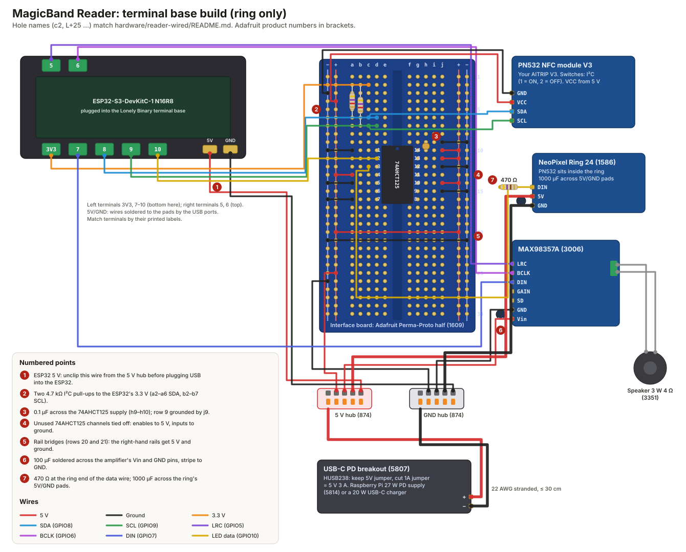
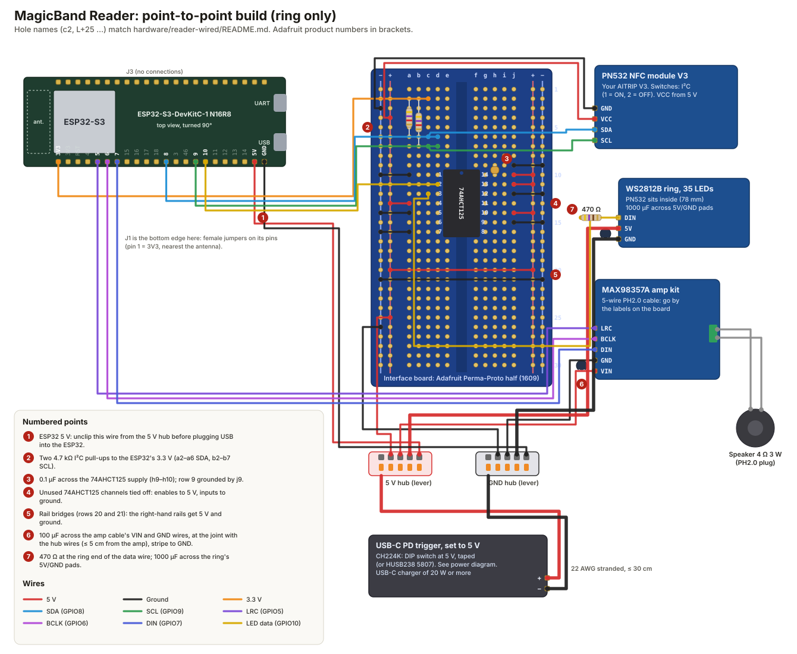
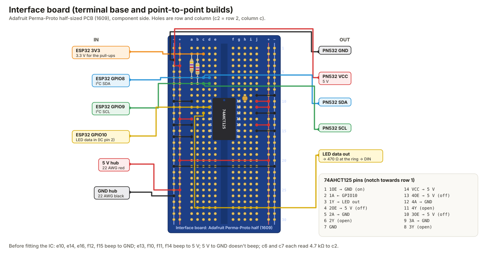

# Build the terminal-base or point-to-point reader: step by step

Every step, in order, with checks along the way. **Build the
[breadboard version](../reader-breadboard/build.md) first**: these builds
use the same parts and settings, and a working breadboard tells you every
part is good.

Hole names on the interface board (`c6`, `L+25`) match the
[interface board picture](../../docs/reader-interface-board.svg) and the
[layout table](README.md#perma-proto-layout).

| Terminal base | Point-to-point |
|---|---|
|  |  |

**Rules for the whole build**

- **Unplug the charger before changing any wiring.**
- **USB and the charger never feed the ESP32 together.** Before plugging USB
  into the ESP32, open the 5 V hub's lever and pull out the **ESP32's 5 V
  wire**. Put it back afterwards.
- **Red is 5 V, black is ground**, everywhere.
- Any check that fails: stop and fix it before going on. The breadboard
  guide's [troubleshooting table](../reader-breadboard/build.md#troubleshooting)
  applies here too.

## Before you start

The breadboard build's parts, without the breadboard and its jumpers, plus:

| Part | For |
|---|---|
| Half-size solderable breadboard PCB (Perma-Proto or similar) | Interface board, both builds |
| DIP-14 IC socket (optional) | Lets the 74AHCT125 plug in |
| Lonely Binary ESP32-S3 screwless terminal base | Terminal-base build |
| 6 female-to-male Dupont jumpers, 150–200 mm | Point-to-point build |
| Heat shrink in several sizes | Every soldered joint |

If you're reusing the breadboard's parts: the PD trigger (already at
5 V), the hubs and the ring (already wired) carry straight over.

## Compact (solderless) version

The point-to-point build with **nothing soldered on the breadboard**: the
interface board is a **400-point half breadboard** at the same holes, and the
ESP32 stays in its **screwless terminal holder** (or uses female-to-male
jumpers on its pins). See the [compact diagram](../../docs/reader-compact.svg).

**Tested** (18 Nov 2026): power, the NFC reader (bands read, known bands
welcomed, unknown denied) and the amplifier at 100 %, first on USB, then on
the USB-C PD supply with the hubs (lowest reading under load: 4.95 V). Only
the ring is still to be tested.

### What you need

The parts in [Before you start](#before-you-start), minus the Perma-Proto,
plus:

- a **400-point half breadboard**;
- **male-to-male** jumpers;
- **male-to-female** jumpers. If you only have male-to-male and
  female-to-female, push one into the other to make one;
- a soldering iron, for the PN532's header only;
- a multimeter.

Until the ring, the PD trigger and the lever connectors are fitted, it runs
from the **ESP32's own USB port**. On USB alone the board's 5V pin feeds the
breadboard's rails (about 4.6–4.9 V). Never connect the USB-C charger or PD
trigger at the same time.

### 1. Flash the ESP32

Install from the [web installer](https://legal-copy7045.github.io/Magic-bHAnds/)
over the **UART** port, enter Wi-Fi, and add the reader in Home Assistant.
Leave **Allow the device to perform Home Assistant actions** (ESPHome → the
reader → Configure) **off**: tag scans don't need it (see
[docs/security.md](../../docs/security.md)). Set **LED count** under the
reader's **Configuration** once it's online.

### 2. Solder the PN532's header

1. Use the **4-pin** right-angle header in the holes marked **GND, VCC,
   SDA, SCL**. Leave the 8-pin row (SPI) empty.
2. Push the short legs in from the **top** (the side with the labels and the
   chip). The plastic strip sits on top; the long legs point straight out
   past the board's edge.
3. Solder on the **bottom**: one pin first, check the header sits square,
   then the other three.
4. Check with the meter on continuity: **GND–VCC, VCC–SDA, SDA–SCL** must
   not beep.
5. Set the mode switches: **1 ON, 2 OFF** (I²C).

### 3. Check the breadboard

- Row 1 at the top, columns **a–e** left and **f–j** right.
- **L+ / L−** are the left-hand **+** and **−** rails, **R+ / R−** the
  right-hand ones (go by the colour markings).
- Each rail beeps from top to bottom.
- **a5–e5** beeps; **e5–f5** (across the middle gap) doesn't.
- A 400-point board's rails have 25 holes in groups of 5, so they don't line
  up with the row numbers. Any hole on the right rail will do: "L−10" means
  the left − rail, near row 10.

### 4. Pull-up resistors

- 4.7 kΩ (yellow, violet, red) from **a2 to a6**, and another from
  **b2 to b7**, lying flat.
- Check: **c2–c6** and **c2–c7** read about **4.7 kΩ**, **c6–c7** about
  **9.4 kΩ**.

### 5. Level-shifter links (chip not fitted yet)

| Left side | Right side | Rails |
|---|---|---|
| a10 → L− | j9 → R− | **L+20 → R+20** |
| a13 → L+ | j10 → R+ | **L−21 → R−21** |
| a14 → L− | j11 → R+ | |
| a16 → L− | j12 → R− | |
| | j14 → R+ | |
| | j15 → R− | |

Fit **0.1 µF** across **h9–h10**: a ceramic "104" either way round, or a
0.1 µF electrolytic with its **stripe in h9**.

### 6. Check the links

Meter on continuity:

- **To L−** (beep): e10, e14, e16, f12, f15, h9.
- **To L+** (beep): e13, f10, f11, f14, h10.
- **L+–R+** and **L−–R−** beep (the rail bridges).
- **L+–L−** gives no steady beep (a short chirp from the capacitor is fine).

If the right-hand ground holes (f12, f15, h9) don't beep, the **L−21 → R−21**
bridge is missing.

### 7. Fit the 74AHCT125

- Straighten its legs against the table first.
- Fit it **notch towards row 1** with **pin 1 in e10**: pins 1–7 down
  column e (rows 10–16), pins 14–8 down column f.
- Press it in evenly, and check no leg has folded under.

### 8. Connect the ESP32 (USB unplugged)

From the holder's terminals with male-to-male jumpers (press the terminal's
release, push the pin in, let go, tug to check), or from the ESP32's pins
with male-to-female jumpers. Go by the printed labels:

| ESP32 | Breadboard |
|---|---|
| **3V3** | **c2** (any of a2–e2 is the same connection) |
| **8** | **d6** |
| **9** | **d7** |
| **10** | **d11** |
| **5V** | **L+**, near row 28 |
| **GND** (any) | **L−**, near row 29 |

### 9. Power up

1. With USB unplugged, check: **L+–L−** gives no steady beep; **c2–L+**
   doesn't beep; **c2–L−** gives no steady beep.
2. Plug USB into the ESP32's **UART** port.
3. Measure: **L+–L−** about 4.6–4.9 V; **c2–L−** 3.2–3.4 V.
4. The reader shows **online** in Home Assistant.

### 10. PN532: check it before connecting its data lines

1. USB unplugged. Plug the PN532's header legs into **a24–a27**, one per
   row; it stands on its edge. Note which row each pin landed in (here
   **GND 24, VCC 25, SDA 26, SCL 27**).
2. Jumpers: **GND row → L−**, **VCC row → L+**. Leave SDA and SCL loose.
3. Plug USB in and measure to L−: VCC about 4.6–4.9 V, **SDA and SCL below
   3.6 V** (2.3 V and 1.1 V on the tested board).
   - **Near 5 V: stop.** That module would damage the ESP32.

### 11. PN532: data lines

1. USB unplugged. Jumpers: **SDA row → c6**, **SCL row → c7**.
2. Plug USB in. This restarts the reader, which only looks for the PN532 at
   start-up.
3. **c6** and **c7** read 3.2–3.4 V to L−.
4. Logs: **Found i2c device at address 0x24**, and no `Error sending version
   command`.
5. Tap a band flat on the PN532's antenna. **Last band ID** shows its ID (and **Last band name** its name, once the MagicbHAnds integration is set up), and a
   band nobody owns is **denied** (error sound).

### 12. Let a band in

1. **Settings → Devices & services → MagicbHAnds → Configure → Add or assign
   a band**: pick the band, choose its owner, submit.
2. The reader's **Known bands** goes up by one within seconds.
3. Tap again: **welcomed**.

Linking the band's Bluetooth side (**Configure → Link a band's Bluetooth**)
passes ownership across if the NFC band has no owner yet. Linking alone
used to drop it, before 0.9.7.

### 13. Amplifier (USB unplugged)

| Connection | Holes |
|---|---|
| ESP32 **5** / **6** / **7** | **f17** / **f18** / **f19** |
| 100 µF | **stripe in g23**, other leg **g24** |
| Ground | **L− → f23** |
| Amplifier cable (by the labels on the amplifier) | **LRC h17**, **BCLK h18**, **DIN h19**, **GND h23**, **VIN h24** |
| Speaker | into the amplifier's 2-pin socket |

Leave the amplifier's 5 V (**L+ → f24**) off for now.

### 14. Power up the amplifier

1. With USB unplugged, check: **f23–L−** beeps; **f24–L−** gives no steady
   beep; **f17, f18, f19** don't beep to L−.
2. Plug USB in. Set the reader's **Speaker** volume to about 30 %.
3. Fit **L+ → f24** with it running. **f24–L−** reads about 4.6–4.9 V.
4. Tap a band: tap-in sound (known) or error sound (unknown).
5. Raise the volume a step at a time. On the tested build, 100 % ran from a
   USB supply without the reader restarting. If yours restarts, step back
   down until the PD supply is fitted.

### Still to come

- **The ring:** solder its wires with the 470 Ω at DIN and the 1000 µF
  across its pads ([breadboard step 5](../reader-breadboard/build.md#step-5-wire-the-led-ring)),
  then connect its data to **c12** through the 470 Ω, and its power to the
  hubs.
- **Power** (tested 18 Nov 2026): set the PD trigger to 5 V (it read
  5.1 V), then make up the two 5-way lever-connector hubs:

  | Port | 5 V hub | GND hub |
  |---|---|---|
  | 1 | PD trigger **+** | PD trigger **−** |
  | 2 | **L+** rail (near row 25) | **L−** rail (near row 26) |
  | 3 | Amplifier **f24** (remove the L+ → f24 jumper) | Amplifier **f23** (remove the L− → f23 jumper) |
  | 4 | Ring 5V | Ring GND |
  | 5 | ESP32 5V (a wire soldered to the holder's 5V pad; remove its 5V → L+ jumper) | ESP32 GND (soldered to the holder's GND pad) |

  - **Keep a short ground jumper from the ESP32 to the breadboard**
    (the holder's GND terminal → **L−**), and add **L− → f23** for the
    amplifier, as well as their hub wires. Without them the sound
    signals' only ground return runs through the hub, and the sound
    **crackles at any volume** on the PD supply.
  - The ESP32's 5 V wire in the hub is now the one to unclip before
    using USB.
  - Then run the full-volume load test (Part 5, stage 4). Tested: repeated
    taps at 100 % volume, the 5 V hub never fell below **4.95 V**, the sound
    stayed clean, and nothing restarted or got warm.

### Other tag automations

Every tap is a Home Assistant **tag scan**, so any automation that triggers
on *any* `tag_scanned` event (for example, one that logs NFC tags around the
house) will run for band taps too. Make it ignore readers with this
condition:

```yaml
conditions:
  - condition: template
    value_template: >-
      {{ not d or 'magicband' not in (device_attr(d, 'model') or '') }}
```

The `not d` part matters: `device_attr` raises an error when a scan has no
device.

## Part 1: parts shared with the breadboard

Do these as in the breadboard guide, if you haven't already:

1. [Install the firmware on the bare ESP32](../reader-breadboard/build.md#step-1-install-the-firmware-on-the-bare-esp32)
   and set **LED count**.
2. [Set the PD trigger to 5 V](../reader-breadboard/build.md#step-2-set-the-usb-c-pd-trigger-to-5-v)
   and tape the switch.
3. [Make up the power hubs](../reader-breadboard/build.md#step-3-make-up-the-power-hubs):
   trigger + / − into the first port of each hub. The other wires here are
   different (step 6 below).
4. [Wire the LED ring](../reader-breadboard/build.md#step-5-wire-the-led-ring):
   power pair, 1000 µF and the data wire with its 470 Ω at the ring. Leave
   the data wire's far end stripped 6 mm and untinned: it's soldered to
   the interface board.
5. [Set the PN532's switches](../reader-breadboard/build.md#step-6-prepare-the-pn532)
   to I²C (1 ON, 2 OFF).

## Part 2: the interface board

It holds the 74AHCT125 and the two I²C pull-ups.



### Step 1. Fit and solder the parts

Solder each part from the top, legs through, then trim the legs underneath.

1. **IC socket** (or the 74AHCT125 itself): pin 1 in **e10**, notch towards
   **row 1**. Pins 1–7 run down column e (rows 10–16), pins 14–8 down
   column f. If you solder the chip directly, solder it last (after step 2's
   continuity check).
2. **4.7 kΩ** from **a2 to a6** (SDA pull-up) and **b2 to b7** (SCL pull-up).
3. **0.1 µF** ceramic from **h9 to h10**.

### Step 2. Solder the tie-off and rail links

Short pieces of bare or insulated wire, hole to hole:

| From | To | Purpose |
|---|---|---|
| a10 | L−10 | Pin 1 (1OE) to GND: enables channel 1 |
| a13 | L+13 | Pin 4 (2OE) to 5 V: disables channel 2 |
| a14 | L−14 | Pin 5 (2A) to GND: unused input |
| a16 | L−16 | Pin 7 to GND |
| j10 | R+10 | Pin 14 (VCC) to 5 V |
| j11 | R+11 | Pin 13 (4OE) to 5 V |
| j12 | R−12 | Pin 12 (4A) to GND |
| j14 | R+14 | Pin 10 (3OE) to 5 V |
| j15 | R−15 | Pin 9 (3A) to GND |
| j9 | R−9 | Grounds the 0.1 µF |
| L+20 | R+20 | 5 V rail bridge |
| L−21 | R−21 | GND rail bridge |

### Step 3. Check the board (chip out of its socket)

Meter on continuity:
- **To GND (beep):** e10, e14, e16, f12, f15 (IC pins 1, 5, 7, 12, 9).
- **To 5 V (beep):** e13, f10, f11, f14 (IC pins 4, 14, 13, 10).
- **5 V to GND: no beep.**

Meter on resistance: c6 to c2 and c7 to c2 each read **4.7 kΩ**.

### Step 4. Solder the wires that leave the board

Cut each wire to length (≤ 20 cm unless stated), solder one end into its
hole, and label the other end with tape.

| Hole | Wire | Goes to |
|---|---|---|
| **L+25** / **L−26** | red / black | 5 V hub / GND hub (11 mm strip, untinned) |
| **c2** | orange | ESP32 **3V3** |
| **d6** / **d7** | blue / green | ESP32 **GPIO8** / **GPIO9** |
| **d11** | yellow | ESP32 **GPIO10** |
| **c6** / **c7** | blue / green | PN532 **SDA** / **SCL** |
| **L+4** / **L−3** | red / black | PN532 **VCC** / **GND** |
| **c12** | the ring's data wire | Already has the 470 Ω at the ring end |

For the PN532: solder female-to-male jumpers (male end cut off) to the
board, so their female ends plug onto the PN532's header. Or fit a 2.54 mm
pin header in those holes and use female-to-female jumpers.

### Step 5. Fit the chip

Push the 74AHCT125 into its socket: notch towards row 1, pin 1 at e10.

## Part 3: the ESP32 connections

Do **3A** for the terminal base or **3B** for point-to-point.

### Step 3A. Terminal base

1. Seat the ESP32 on the base, antenna end matching the base's outline.
2. Check the terminal labels on your base against this table before wiring.
3. **5 V and GND:** if the base has no 5V terminal, solder a red and a black
   22 AWG wire to its **5V** and **GND** pads. Lever end stripped 11 mm.
4. Strip each wire 8–10 mm (untinned) and push it into its terminal:

| Terminal | Wire from |
|---|---|
| Left **3V3** | Interface board c2 |
| Left **8** / **9** | Interface board d6 / d7 |
| Left **10** | Interface board d11 |
| Right **5** / Right **6** / Left **7** | Amplifier cable LRC / BCLK / DIN (Dupont ends cut off; step 7) |

### Step 3B. Point-to-point

1. Header **J1** is on the left with the antenna at the top (component side
   up); J1-1 is nearest the antenna.
2. Six female-to-male jumpers: cut off the male ends, strip 6 mm.
3. Solder the cut ends to the interface board's wires (heat shrink over
   each joint), then push the female ends onto the pins:

| J1 pin | Signal | Wire from |
|---|---|---|
| **J1-1** | 3V3 | Interface board c2 |
| **J1-12** | GPIO8 | Interface board d6 |
| **J1-15** | GPIO9 | Interface board d7 |
| **J1-16** | GPIO10 | Interface board d11 |
| **J1-21** | 5V | 5 V hub (this is the one to pull before USB) |
| **J1-22** | GND | GND hub |

The amplifier's LRC, BCLK and DIN go on **J1-5**, **J1-6** and **J1-7**
(step 7).

## Part 4: power, amplifier and ring

### Step 6. Wire the hubs

Each hub has five ports. Port 1 is the PD trigger (Part 1).

| Port | 5 V hub | GND hub |
|---|---|---|
| 2 | Interface board L+25 | Interface board L−26 |
| 3 | Amplifier VIN (step 7) | Amplifier GND (step 7) |
| 4 | Ring 5V | Ring GND |
| 5 | ESP32 5V | ESP32 GND |

Connect **ground before 5 V** on each part.

**Also keep the ESP32's ground on the interface board:** a short wire from
the ESP32's GND (point-to-point: another J1-22 lead; terminal base: a GND
terminal) to the interface board's **L−**. The sound and LED signals
reference it; with ground only through the hub, the amplifier crackles.

### Step 7. Amplifier

1. Plug the PH2.0 cable into the amplifier. Read the **labels printed on
   the amplifier** and follow each wire to its Dupont end; label them.
2. **Power:** cut the Dupont ends off the **VIN** and **GND** wires. Cut a
   red and a black 22 AWG wire (≤ 30 cm) for the hubs. Slide on heat
   shrink, then solder VIN to red and GND to black, with the **100 µF
   soldered across the two joints** (stripe to GND), within 5 cm of the
   amplifier. Insulate everything.
3. **I²S:** LRC → GPIO5, BCLK → GPIO6, DIN → GPIO7:
   - Point-to-point: female Dupont ends plug straight onto J1-5, J1-6 and
     J1-7 (male ends: join with female-to-female jumpers).
   - Terminal base: cut the Dupont ends off, strip 8–10 mm, push into the
     **5**, **6** and **7** terminals.
4. Keep these three wires together, alongside the amplifier's GND, under
   about 20 cm.
5. Plug the speaker into the amplifier's 2-pin PH2.0 socket.

### Step 8. Ring and PN532

1. Ring **GND** into GND hub port 4, then **5V** into 5 V hub port 4.
   Its data wire is already on c12.
2. Plug only the PN532's **GND** and **VCC** leads onto its header for now.
   SDA and SCL go on in stage 1, after a check.

## Part 5: test, stage by stage

### Stage 1: power

1. **Disconnect at the hubs:** the ESP32's 5 V, the amplifier's VIN and the
   ring's 5V. Leave the interface board connected.
2. Plug in the charger. Measure hub 5 V to GND **4.75–5.25 V**, and the
   interface board's L+25 to L−26 the same.
3. Measure IC pin 14 to pin 7 (j10 to a16): **4.75–5.25 V**.
4. **PN532 clone check:** it's powered, with SDA and SCL not yet
   connected. Measure its SDA and SCL header pins to GND: **below 3.6 V**
   (typically 2.5–3.3 V, or near 0 V). **Stop if either reads near 5 V**:
   that clone would damage the ESP32.
5. Unplug the charger. Plug the PN532's **SDA** and **SCL** leads on, and
   reconnect the ESP32's 5 V. Plug in the charger. Measure the ESP32's 3V3
   pin to GND **3.2–3.4 V**, and the PN532's SDA and SCL to GND
   **3.2–3.4 V**.
6. *Logs*: it boots, connects, finds the PN532 at **0x24**. Tap a band: its
   ID appears.

### Stage 2: ring

1. Unplug the charger. Reconnect the ring's 5V. Plug in the charger.
2. The idle glow shows. Turn on **Ring**: red, green and blue at 100 % on
   all 35 LEDs. Swapped colours: **LED colour order**.

### Stage 3: sound

1. Unplug the charger. Reconnect the amplifier's VIN. Plug in the charger.
2. The start-up sound plays. **Test welcome**: ring green, tap-in sound.

### Stage 4: everything at once

1. **Ring** white at 100 %, **Speaker** volume 100 %, press **Test
   welcome** for a minute, then tap bands.
2. Hub voltage stays **at least 4.75 V**; *Uptime* doesn't reset; nothing
   gets more than barely warm.

### Stage 5: in the case

1. Fix the modules so no joint can flex. Put the PN532 antenna in the
   centre of the ring, under the lid, with no metal between it and the
   band.
2. Run the [checklist in hardware/README.md](../README.md#checking-a-build-works),
   and compare read range, volume and LED behaviour with the breadboard.

Then set it up in Home Assistant as in the breadboard guide's
[Part 3](../reader-breadboard/build.md#part-3-set-it-up-in-home-assistant).
