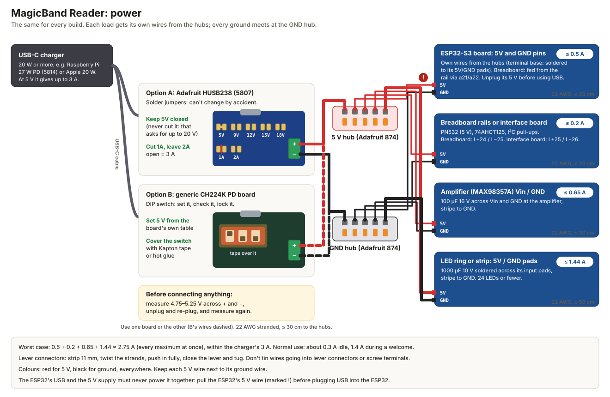

# MagicBand Reader: shopping list (Adafruit)

Exact parts for the reader, from Adafruit where they sell a suitable part.
Each one was checked against its Adafruit product page or guide. Stock
changes often: check availability before ordering.

The same core parts serve all three builds
([breadboard](reader-breadboard/README.md),
[terminal base and point-to-point](reader-wired/README.md)); the last two
tables list what each build adds.

## Core parts (every build)

| Qty | Part | Adafruit | Why this one |
|---|---|---|---|
| 1 | NeoPixel Ring, 24 × 5050 RGB LED | [1586](https://www.adafruit.com/product/1586) | 65.5 mm outside, **52.3 mm inside**: the PN532 module (43 × 41 mm) fits inside the ring, so the LEDs stay clear of its antenna. Ships with WS2812B or SK6812 LEDs, same protocol. Matches the firmware's default `ring_leds: 24` |
| 1 | I2S 3W Class D Amplifier Breakout, MAX98357A | [3006](https://www.adafruit.com/product/3006) | The amplifier the firmware is written for. 2.5–5.5 V supply; 1 MΩ on SD gives mono (L+R)/2 at 5 V; 9 dB default gain |
| 1 | Mono Enclosed Speaker, 3 W 4 Ω | [3351](https://www.adafruit.com/product/3351) | Rated for the amplifier's full output (3 W into 4 Ω at 5 V). Adafruit's 8 Ω speakers are 1 W, below what the amplifier can deliver. Its lead ends in a 2-pin JST-PH plug: cut the plug off to use the amplifier's screw terminal |
| 1 | 74AHCT125 Quad Level-Shifter (3V to 5V), DIP-14 | [1787](https://www.adafruit.com/product/1787) | Lifts the ESP32's 3.3 V LED data to the 5 V the LEDs need |
| 1 | Through-Hole Resistors, 4.7 kΩ 5 % ¼ W, pack of 25 | [2783](https://www.adafruit.com/product/2783) | Two I²C pull-ups |
| 1 | Through-Hole Resistors, 470 Ω 5 % ¼ W, pack of 25 | [2781](https://www.adafruit.com/product/2781) | LED data resistor, at the ring. Adafruit recommends 300–500 Ω; it doesn't sell 330 Ω |
| 1 | 100 µF 16 V Electrolytic Capacitors, pack of 10 | [2193](https://www.adafruit.com/product/2193) | Amplifier supply |
| 1 | 0.1 µF ceramic capacitors, 10 pack | [753](https://www.adafruit.com/product/753) | 74AHCT125 supply decoupling |
| 1 | USB Type C Power Delivery Dummy Breakout, HUSB238 | [5807](https://www.adafruit.com/product/5807) | Asks the charger for 5 V 3 A (**keep the 5V jumper, cut the 1A jumper**). Rated to 20 V 5 A, comes with a terminal block |
| 1 | Official Raspberry Pi 27 W PD Power Supply, 5.1 V 5 A, USB-C | [5814](https://www.adafruit.com/product/5814) | True USB Power Delivery, so the HUSB238 gets its 5 V 3 A; 5.1 V output; captive 18 AWG cable. *Or use a USB-C charger of 20 W or more you already have* |
| 1 | Snap-action 5-Wire Block Connector (12–24 AWG), pack of 3 | [874](https://www.adafruit.com/product/874) | Two of them are the 5 V and GND power hubs. 32 A rated |

**Not from Adafruit:**

| Qty | Part | Specification | Why |
|---|---|---|---|
| 1 | **ESP32-S3 board** | ESP32-S3-DevKitC-1 **N16R8** layout (your Lonely Binary N16R8) | Adafruit's DevKitC-1 boards are N8R8 (8 MB flash, product 5336) or WROOM-2 (product 5364). The reader firmware is built for the N16R8's 16 MB flash and octal PSRAM |
| 1 | **PN532 NFC module V3** | Elechouse V3 or clone (your AITRIP) | Adafruit's PN532 breakout (364) is a 3.3 V-only design needing different wiring and 1.5 kΩ pull-ups. The V3 module is what the build docs are written for |
| 1 | **1000 µF electrolytic capacitor** | 10 V or 16 V, radial, 105 °C | Adafruit's closest is 4700 µF 10 V (1589), well above its own 500–1000 µF NeoPixel guidance |

How it all connects: [power diagram](../docs/reader-power.svg).

## Wire and consumables (every build)

| Qty | Part | Adafruit | For |
|---|---|---|---|
| 1 | Hook-up Wire Spool Set, **22 AWG stranded**, 10 × 25 ft | [3175](https://www.adafruit.com/product/3175) | Every wire that isn't plugged into a breadboard: power runs to the hubs, ring, amplifier and supply, the LED data wire, and the point-to-point and terminal-base wiring. Rated 80 °C, 300 V; Adafruit notes it works well in terminal blocks. (The 6-colour set, [3111](https://www.adafruit.com/product/3111), also works) |
| 1 | Solder Wire, 60/40 rosin core, 0.5 mm, 50 g | [1886](https://www.adafruit.com/product/1886) | Ring pads, headers, the interface board |
| 1 | Chip Quik No-Clean Liquid Flux Pen | [3468](https://www.adafruit.com/product/3468) | Clean joints on the ring's small pads |
| 1 | Heat Shrink Pack | [344](https://www.adafruit.com/product/344) | Over the 470 Ω at the ring and every inline joint |
| 1 | High Temperature Polyimide (Kapton) Tape, 1 cm | [3057](https://www.adafruit.com/product/3057) | Insulating the backs of the ring and modules; holding a power board's DIP switch in place |
| — | Cable ties, a hot-glue gun | (any) | Strain relief: secure wires near the ring's pads so they can't pull them off |

## Tools

| Part | Adafruit | Notes |
|---|---|---|
| Soldering iron, temperature controlled | (any) | For the ring pads and headers |
| Wire strippers for 20–30 AWG | [527](https://www.adafruit.com/product/527) (Hakko) or [4747](https://www.adafruit.com/product/4747) (self-adjusting) | Clean strips on 22 AWG |
| Digital multimeter | [2034](https://www.adafruit.com/product/2034) or [850](https://www.adafruit.com/product/850) | **Needed**: every stage of the test plan measures voltage or continuity |
| Helping third hand | [291](https://www.adafruit.com/product/291) | Optional; holds the ring while you solder |

## Wiring guide

Which wire for each connection, and how to finish it. 22 AWG copper is
about 53 mΩ per metre, so the length limits keep each run's voltage drop
under about 0.1 V.

| Connection | Wire | Colour | Max length | Ends |
|---|---|---|---|---|
| Power board → 5 V / GND hubs | 22 AWG stranded | **red / black** | 30 cm | Screw terminal → lever connector |
| Hubs → LED ring 5V / GND | 22 AWG stranded | **red / black** | 50 cm | Lever connector → **soldered** to the ring's pads; 1000 µF soldered across the same pads |
| Hubs → amplifier Vin / GND | 22 AWG stranded (solid on a breadboard) | **red / black** | 30 cm | Lever connector → amplifier header (soldered, or into its breadboard row) |
| Hubs → ESP32 5V / GND | 22 AWG (solid on a breadboard; female jumper on point-to-point; soldered to the terminal base's pads) | **red / black** | 20 cm | Lever connector → board. **The 5 V one must be easy to unplug** (USB rule) |
| Hubs → breadboard or interface-board rails | 22 AWG (solid on a breadboard, stranded to the Perma-Proto) | **red / black** | 20 cm | Lever connector → rail |
| ESP32 3V3 → pull-ups | 22 AWG | **orange** (or any spare colour) | 20 cm | |
| GPIO8 SDA / GPIO9 SCL → PN532 | 22 AWG, then female jumpers onto the PN532 header | **blue / green** | 20 cm in total | Keep the two together |
| GPIO10 → level shifter | 22 AWG | **yellow** | 15 cm | |
| Level shifter out → ring DIN | 22 AWG stranded | **yellow** | 50 cm | **470 Ω soldered inline at the ring end**, in heat shrink. Run it alongside the ring's power pair |
| GPIO5 / 6 / 7 → amplifier LRC / BCLK / DIN | 22 AWG | **three distinct colours** (e.g. purple, grey, white) | 20 cm | Keep the three together, alongside the amplifier's GND |
| Amplifier → speaker | The speaker's own lead, plug cut off | as supplied | as supplied | Screw terminal. Neither wire is ground |

**Finishing wires:**
- **Lever connectors (874):** strip **11 mm** (Adafruit's spec), twist
  the strands, push in fully, close the lever, and tug to check.
- **Don't tin wire going into a lever connector or screw terminal.**
  Solder creeps under clamping pressure, and the joint loosens over time.
  Twist the strands instead.
- **Screw terminals** (amplifier, power board): strip about 5 mm, so no
  bare copper shows outside the terminal once it's tightened.
- **Soldering to the ring:** flux, tin the pad and the wire first, then
  join them quickly. Its pads are small and can lift with too much heat or
  a tug. Hot-glue or tie the wires down near the pads for strain relief.
- **Inline joints** (the 470 Ω, any extensions): slide heat shrink on
  first, then solder, then shrink.
- **Never let 5 V touch a GPIO wire.** Check with the meter before each
  power-up, as the test plan says.

## If a ring won't fit: flexible LED options

For a ready-made housing, a short length of flexible NeoPixel strip can
replace the ring. Every option below is 5 V, uses the same three wires
(5V, DATA, GND), and needs the same 470 Ω and 1000 µF at its input end.
Set `ring_leds` to the number of LEDs you use. The wiring and diagrams are
the same as for the ring: a strip's input end takes the place of the ring's
DIN, 5V and GND pads.

**Changing `ring_leds` or `ring_color_order`:** the web installer's firmware
is built for the NeoPixel Ring 24 (24 LEDs, GRB). For another count or
colour order, adopt the reader in the ESPHome Device Builder (**Take
control**) and set them in its `substitutions:`, then install from there.

**How many LEDs:** loop length (mm) × LEDs per metre ÷ 1000. A loop 60 mm
across is about 190 mm long. Keep it to **24 LEDs or fewer**: the current
budget above assumes 24 (1.44 A at full white). Cut only at the marked cut
lines, and wire to the end marked as the input (arrows point away from it).

| Adafruit | Strip | Width | LEDs/m (60 mm loop) | Light comes out | Notes |
|---|---|---|---|---|---|
| [3634](https://www.adafruit.com/product/3634) | NeoPixel **Side Light** Strip, black, 120 LED | 10 mm | 120 (≈ 22) | **Edge** | **Best match.** Curled into a loop standing on its edge, it shines upward like a ring. Adafruit's own Magic Band Reader uses this strip. Also [3635](https://www.adafruit.com/product/3635) (90/m) and [3636](https://www.adafruit.com/product/3636) (60/m, 8 mm) |
| [4310](https://www.adafruit.com/product/4310) | Flexible Silicone **Neon-like** Skinny NeoPixel | 12 × 6 mm | 96 (≈ 18) | Edge, through a silicone diffuser | Smoothest glow (side-light strip inside silicone). Arrives as 1 m sealed at one end, with a JST SM input. **Colour order is RGB, not GRB**: set `ring_color_order: RGB` (see below) |
| [2963](https://www.adafruit.com/product/2963) / [2964](https://www.adafruit.com/product/2964) | **Mini Skinny** NeoPixel, 60 LED/m | 7.5 mm | 60 (≈ 11) | Face of the strip | Lines a housing wall, facing inward. Needs a diffuser to look continuous. 30/m ([2958](https://www.adafruit.com/product/2958)) is too sparse for a small loop |
| [4368](https://www.adafruit.com/product/4368) | **Ultra Skinny** NeoPixel 1515, 4 mm | 4 mm | 150 (cut to ≤ 24) | Face of the strip | Tightest spaces; cut every 7 mm. Adafruit warns it shouldn't be flexed repeatedly: shape it once |

**Not suitable:**
- **Neon-like LED Flex Strip with Silicone Tube (3869):** 12 V (WS2811),
  so it can't share the reader's 5 V supply.
- **LED Dots and Pebble strands (3630, 5225, 4560 and similar):** one LED
  every 50–100 mm, so only 2–4 LEDs on a small loop.
- **RGBW strips:** the firmware drives RGB LEDs.
- **144 LED/m strips** (e.g. [2970](https://www.adafruit.com/product/2970)):
  usable, but a 60 mm loop would hold 27 LEDs, over the 24-LED budget.
  Cut to 24 at most.

Not stated by Adafruit: the smallest safe bend for each strip. Try the
loop size with the strip unpowered before you commit to the housing.

## Generic alternatives

Generic parts (from Amazon and similar) work for almost everything.
What to check on the listing:

| Adafruit part | Generic? | Check on the listing |
|---|---|---|
| NeoPixel Ring 24 (1586) | Yes | **WS2812B** or **SK6812**, **5 V**, pads for DIN, 5V and GND. Not WS2811 (usually 12 V) or APA102 (4 wires). Inside diameter **about 45 mm or more**, so the PN532 fits inside |
| MAX98357A (3006) | Yes | Pins LRC, BCLK, DIN, GAIN, SD, GND, VIN. ⚠️ Adafruit's board has 1 MΩ from SD to Vin; without it the amplifier stays off. Stage 4 of the test plan catches this (SD should read about 0.45 V); if it reads near 0 V, add a 1 MΩ from SD to Vin |
| Speaker 3 W 4 Ω (3351) | Yes | **4 Ω or more**, rated **3 W or more** |
| 74AHCT125 (1787) | ⚠️ Only the right chip | **74AHCT125** or **74HCT125**, DIP-14. **Not 74HC125**: its input threshold at 5 V is too high for 3.3 V logic. **Not** "4-channel level shifter" modules (BSS138 MOSFET or TXS0108E types): unreliable at the LEDs' data rate |
| Resistors, capacitors | Yes | Any assortment kit: 4.7 kΩ, 470 Ω; capacitors rated **10 V or more** |
| HUSB238 PD breakout (5807) | ⚠️ With care | A **CH224K** PD board with a DIP switch works: set it to **5 V** from the board's own table, measure **4.75–5.25 V** with nothing connected, unplug and re-plug and measure again, then **cover the switch** with Kapton tape or hot glue. A bumped switch would send up to 20 V into everything. Avoid boards that can't select 5 V, and plain USB-C sockets without CC resistors. See the [power diagram](../docs/reader-power.svg) |
| Raspberry Pi 27 W PD supply (5814) | Yes | Any USB-C charger of **20 W or more**, with a cable rated 3 A or more |
| Snap-action connectors (874) | Yes | Genuine **Wago 221-415** (5-way) is the same job |
| 22 AWG wire | Yes | **Pure copper**, not CCA (copper-clad aluminium) |
| Breadboard 830 (239) | Yes | Cheap ones can have loose contacts or split rails; the build's rail bridges and continuity check cover that |
| Jumpers, heat shrink, Kapton tape, solder | Yes | Any |
| Perma-Proto half (1609) | Yes | A half-size solderable breadboard PCB with **30 rows, columns a–j and a rail pair down each side**; the interface board layout assumes that |
| Flexible LED strips | Mostly | **5 V WS2812B or SK6812**. ⚠️ Many "silicone neon" strips are **12 V WS2811**. Colour order varies: set `ring_color_order` if colours come out swapped |

## Breadboard build adds

| Qty | Part | Adafruit |
|---|---|---|
| 1 | Full Sized Premium Breadboard, 830 tie points | [239](https://www.adafruit.com/product/239) |
| 1 | Breadboarding wire bundle | [153](https://www.adafruit.com/product/153): pre-cut jumpers for the short links on the board |
| 1 | Premium Female/Male Jumper Wires, 40 × 150 mm | [826](https://www.adafruit.com/product/826) (PN532 leads) |
| 1 | Hook-up Wire Spool Set, **22 AWG solid**, 10 × 25 ft | [3174](https://www.adafruit.com/product/3174): wires that plug into the breadboard (hub feeds, amplifier power). Or just the red and black spools, [288](https://www.adafruit.com/product/288) and [290](https://www.adafruit.com/product/290) |

## Terminal base and point-to-point builds add

| Qty | Part | Adafruit / source |
|---|---|---|
| 1 | Perma-Proto Half-sized Breadboard PCB | [1609](https://www.adafruit.com/product/1609): the interface board, laid out like the breadboard |
| 1 | Premium Female/Male Jumper Wires, 40 × 150 mm | [826](https://www.adafruit.com/product/826): PN532 leads; for point-to-point also the ESP32 leads (female end on the pin, male end cut off and soldered) |
| 1 | Lonely Binary ESP32-S3 pluggable terminal-block base | Lonely Binary (terminal base build only) |

## If you use a charger you already have

Any USB-C charger of **20 W or more** works instead of the Raspberry Pi
supply: at 5 V, USB-C gives up to 3 A. Use a USB-C cable rated for 3 A or
more, such as Adafruit's
[USB C to USB C Cable with E-Mark, 1 m (4199)](https://www.adafruit.com/product/4199).

## Current budget with these parts

| Load | Worst case |
|---|---|
| NeoPixel Ring 24, full white (60 mA per LED, Adafruit) | 1.44 A |
| MAX98357A into 4 Ω at full volume (Adafruit: up to 650 mA) | 0.65 A |
| ESP32-S3 board (*estimate*) | 0.50 A |
| PN532 module (*estimate*) | 0.15 A |
| 74AHCT125, pull-ups | 0.01 A |
| **Total** | **≈ 2.75 A**, within 3 A |

That worst case stacks every maximum at once: the ring at full white
(the firmware only does that if Home Assistant asks), full volume and a
Wi-Fi transmit peak. In normal use the reader draws about 0.3 A idle and
about 1.4 A during a welcome.
